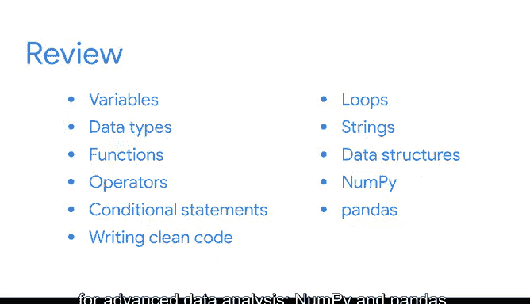

# 谷歌高阶数据分析 2：《Python入门》get-started-with-python（中英双字） - P50：50_05_03_课程总结.zh_en - GPT中英字幕课程资源 - BV1Jm4y177BW

Congratulations， you have completed the end of course project。

You now have a tangible product you can present to future employers that demonstrate your Python proficiency。

 Wow， you've learned so many new Python skills。 First。

 you learned how to use variables to store and label your data。

 And how to convert and combine different data types such as integers and floats。 Next。

 you learned how to call functions to perform useful actions on your data。

 and use operators to compare values。 You also learned how to write conditional statements to tell the computer how to make decisions based on your instructions。

 And you practice writing clean code that can be easily understood and reused by other data professionals。

 Then you discovered how to use loops to automate repetitive tasks。

 You also learned how to manipulate strings by slicing， indexing and formatting them。 After that。

 you explored fundamental data structures。 such as lists， tuples， dictionaries， sets and arrays。😊。

Lastly， you learned about two of the most widely used and important Python tools for advanced data analysis。

 Numpy and pandas。

Coming up， you have even more exciting discoveries to make now that you understand how to create systems to prepare data for stakeholders。

 It's time to start thinking about how to present that data and make it useful for decision making。😊。

You now have a strong foundation of Python skills that you can continue to build on in your future career as a data professional。

 So go get ready and continue your learning journey。😊。

