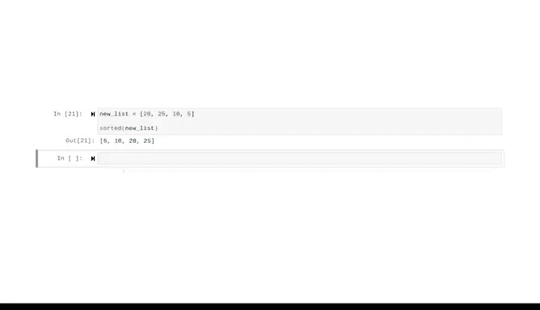

# 谷歌高阶数据分析 2：《Python入门》get-started-with-python（中英双字） - P5：05_01_01_深入了解Python.zh_en - GPT中英字幕课程资源 - BV1Jm4y177BW

Previously， you learned that Python is a high level programming language。

 This means that Python uses more human friendly syntax and more closely resembles a spoken language。

 In fact， Python is simple enough that you can learn some of its basic concepts just by example。

 In this video， I'll demonstrate some of the fundamentals of Python。

I'll introduce you to some new terms， but we won't take into account formal definitions and processes we'll consider these things in more detail later。

For now， just take a moment to get familiar with the code and how it works。

The first thing we'll do is print to the console。If we tell the computer to print Hello world。

 it will output hello world for us。In fact， the print function will output whatever we enter in its parentheses。

Of course， Python is also capable of performing computations。 If we divide the sum of 5 and 4 by 3。

 we get 3。😊，And Python， we can also assign variables。

 You can think of a variable like a container that you can name。

A container's contents are known as its value。For example， here we create two new variables。

 The first variable is called country， and we're assigning to it the value of Brazil。

The second variable is called age。 We'll assign at the value of 30。

Now we can refer to the values Brazil and 30 by their variable names。

When I give the country variable to the print function， it returns Brazil。Similarly。

 when I give the age variable to the print function， it returns 30。😡。

Python can also be used to evaluate statements。 For example。

 I can check if 10 to the third is equal to 1000。It is， so the computer returns true。

Notice that so far Ive used the plus sign for addition， the forward slash for division。

 and two asterisks to indicate an exponent。Like in mathematics， these signs are known as operators。

 A lot of them are straightforward。 However， some might not be so simple。 Take this last case。

 for example， I use two equal signs to check the equivalents of two values When used properly。

 The computer will return either true or false。What happens when I use one equal sign？

I get a syntax error。You might have noticed from earlier examples that the single equal sign is reserved for assigning variables。

Just like in spoken languages， Python has rules that govern its construction。

You'll learn many of these rules in this course， but I won't discuss them in detail now。

You won't easily learn a new spoken language by studying a big book of its rules。

 You're more likely to learn it by speaking it， hearing it， reading it， and writing it。

It's also a lot more fun that way。It's the same with Python。 So for now。

 don't worry about memorizing any rules。 First， let's observe Python in action。As you might expect。

 if I make a false equivalency like 10 times 3 equals 40， the computer will return false。

I can even use a variable I defined previously， age in a new statement。10 times 3 does equal age。

You'll recall we assigned age of value of 30 so the computer returns true。

Python also lets me perform actions based on conditional logic。Here。

 I tell the computer that if the value of my age variable is greater than or equal to 18。

 then it should print the word adult。Otherwise， it should print the word minor。

The value stored in the age variable was 30， so the computer returns adult。

Another common task in Python is looping。 Loing performs the same action to each element of something。

Here's a simple loop。For each number in this list of one through 5， we print the number。

 The computer outputs 1，2，3，4，5。 Here's another example。 This time。

 I'll create a list containing the numbers 3，6 and 9， and assign it to a variable named my list。Now。

 I'll loop over my list。 And for each number in the list。

 the computer will print that number divided by 3。 And there you have it。 It outputs 1，2， and 3。Now。

 let's return to the conditional statement we wrote。If age is greater than or equal to 18。

 print adult， otherwise， print minor。What if we want to repeat the same action from many different age values。

 We can write a function。 A function is a chunk of code that can be reused to perform the same task。

Will define this function and call it is adult， and it will accept an argument called age。By the way。

 an argument is information that you give a function in its parentheses。

Now in the body of the function we'll use the same code we use for the conditional statement。

Nothing happens when we run this code。 But check out what happens when we call the function and give it an argument of 14。

The computer returns the word minor。Now， we can perform the same evaluation as many times as we want。

 simply by using the is a dot function we just created。

And remember how I told you that libraries are part of what makes Python such a useful and powerful language。

 Python has its own library of built in functions that perform common tasks。 For example。

 here's a list of numbers，2025，10 and 5。 We'll assign this list to a variable named a new list。

We can use the built in Python function called sorted and enter new list as its argument。

It returns our list with its values sorted from least the greatest。

These are just a few simple examples of what Python can do。

 These simple processes can be stacked and layered and combined to create algorithms and programs that could possibly change the world。

 Python's power is bounded only by the limits of your imagination。

Now that we've explored what Python is and what it can do。

 I'm excited for you to learn more about it。