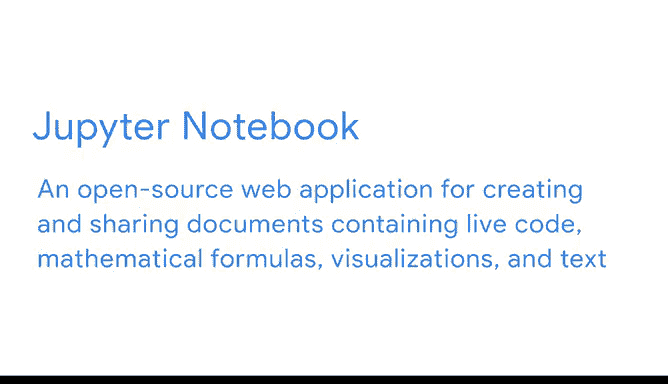
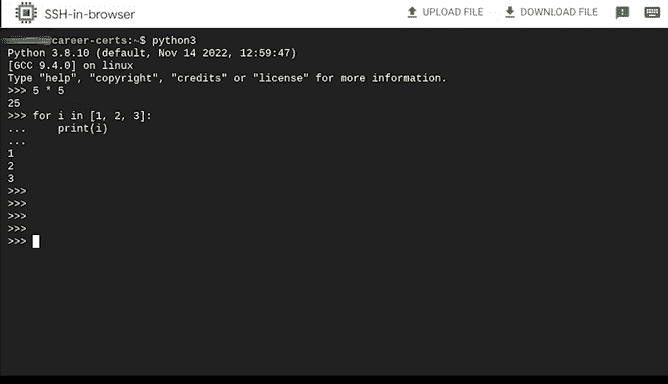
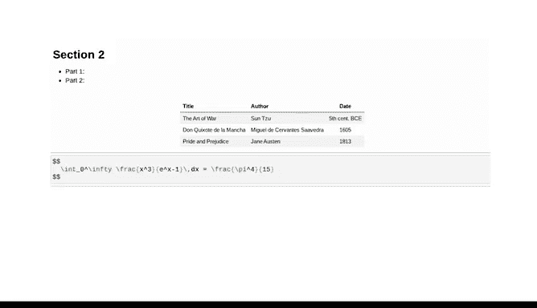

# 谷歌高阶数据分析 2：《Python入门》get-started-with-python（中英双字） - P6：06_01_03_Jupyter笔记本.zh_en - GPT中英字幕课程资源 - BV1Jm4y177BW

Recently， you've been investigating the power of Python。

 There are many environments programmers use when exploring all of Python's capabilities and one of the most populars Jupiter notebook。

😊，You've already encountered Jupipyter Note， The examples that I presented to you previously were done in one will use this platform to write code and perform analysis throughout the course。

We'll also provide you with information about how to set up Jupyter notebook on your own computer。

 but that's optional and not necessary to complete the Advcing analytics program。

Jupiter Note is an open source web application for creating and sharing documents containing live code。

 mathematical formulas， visualizations and text usingsing a Jupyter notebook lets you collaborate on data projects and integrate code plus it puts all of your output in one document。

 which is very useful， especially when first learning about programming。😊。

To illustrate why， take this example in the computing world。

 most code is written in an environment similar to this。This is a terminal based text editor。

 Notice that it's like a single page that's infinitely long。

If I perform an operation or write a line of code， it executes immediately when I move to the next line。

 and I can only move forward。 I can't return to an earlier line of code。

 insert my cursor there and change or run it。 A terminal based text editor is a very useful environment for many。

 many situations。 but it's not always the best or easiest to work with for data analytics projects。😊。

Now， compare that to our notebook environment from before here。

 I can more easily modularize my code into cells to organize them in sections。😡。

Cells are the modular code， input output fields into which Jupiter notebooks are partitioned。

I can move code around。Add it。And delete it with the click of a mouse or the press of a button。

And it's great for visualizations and presentations。😊，I can add comments， annotations。

 and explanations using Markdown syntax。 Markdown lets you write formatted text in a coding environment or plain text editor。

😊，For example， I can add titles and bullets， tables， and mathematical formulas。

These are just a few of the many features of Jupyter notebooks that make it a preferred platform among data professionals。

As you move through this course， you'll create projects in Jupyter notebooks to showcase your skills as a data professional。

