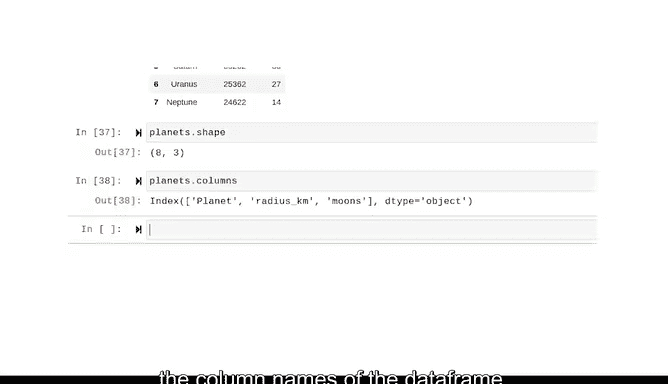

# 谷歌高阶数据分析 2：《Python入门》get-started-with-python（中英双字） - P7：07_01_05_面向对象编程.zh_en - GPT中英字幕课程资源 - BV1Jm4y177BW

You're well on your way now in this video， you'll learn more about Python and what makes it both approachable and powerful as a coding language you're going to learn about object oriented programming。

Specifically， we're going to discuss classes， methods and attributes。

 What follows is a brief introduction to object oriented programming。

 a more detailed discussion is beyond the scope of this course。

You'll have the opportunity to further explore object oriented programming in your future career as a data professional。

Object oriented programming is the programming system that is based around objects which contain both data and useful code that manipulates that data。

 An object is an instance of a class。 Think of it like a fundamental building block of Python。Ls。

 functions， strings， These are all objects。 The main idea behind an object oriented programming is to have both data and the methods that manipulate it within objects。

 allowing for more organized， accessible and reusable code。

 The most important concept in object oriented programming is the class。😊。

A class is an object's data type that bundles data and functionality together。 In other words。

 the reason why it's useful for an object to have a type or belong to a class is because it allows us to build a bunch of useful tools that can be packed directly into the object itself。

 This will make a lot more sense with an example。 When we put the words hocus pocus inside quotations and assign that to a variable called magic。

 This variable becomes an instance of the string class。 because it belongs to the string class。

 It behaves in a certain way and has a lot of built in functionality reserved for strings。

 We can swap the case of the characters by typing magic dot swap case with empty parentheses after it。

 we can replace some characters with new characters by typing magic dot replace and entering the characters we want to replace and what we want to replace them with。

😊，And we can split the string into a list of two strings using dot split and an empty pair of parentheses。

 These actions are known as methods。 A method is a function that belongs to a class and typically performs an action or operation。

😊，They use parentheses。 In our examples， each method acted on the value of our variable。

 It changed it in some way。That's what I mean when I say that methods typically perform an action or operation。

 By the way， you don't have to memorize these methods。 There aren't many people who know all of them。

😡，Most coding environments have ways to access a list of methods available to a given class in Jupyter notebook。

 we type a dot and then hit the Tab key， noticeice that we're attaching the method to its class instance using a dot。

That is called dot notation。 And it's how we access the methods and attributes that belong to an instance of a class。

 There are many different classes in Python。 You've encountered some of these already。

 The core classes of Python are integers， floats， strings， Booles， lists， dictionaries， tuples， sets。

 frozen sets， functions， ranges and none， which is a data type that returns in empty value。

 There are also many additional custom defined classes that come with libraries and packages。

 And you can even make your own。😊，Okay， the last thing we're going to discuss is attributes。

Attributes are values associated with an object or class。

 which are referenced by name using dot notation。They don't use parentheses。

 Attributes are especially important for custom built classes and more complex data structures like data frames。

 You'll learn more about these later。 But here's an example。

 Suppose we have a data frame called planets that contains a row for each planet and columns that represent planet name。

 It radius and the number of moons。 It has one attribute of this data frame would be its shape。

This data frame is eight rows by three columns。Another attribute of the data frame class is columns。

 Call this attribute on the data frame object returns an index object containing the column names of the data frame。

 Attributes allow you to access characteristics of a class。

 but they don't do anything to it or change it。 Perhaps you're beginning to appreciate how object or programming is an ideal structure for data analysis。

 by packaging data together with ways to manipulate it and learn about it。

 Objects are the fundamental building blocks of Python and part of what makes it such a powerful tool for data professionals。

😊。

