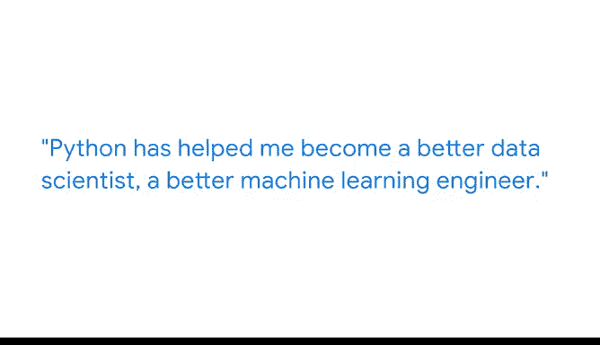

# 谷歌高阶数据分析 2：《Python入门》get-started-with-python（中英双字） - P8：08_01_07_哈姆扎-Python如何助力我的数据科学职业.zh_en - GPT中英字幕课程资源 - BV1Jm4y177BW

My name is Hamza and I'm an applied machine learning engineer。 I love building models。

 I love building large scale systems and that is exactly what I do at work。

 It's a form of art for me that you get to create something from scratch that does not exist and you put it into production and it is used by about 100 million users The scope of my work is to build。

 maintain and productionize large scale models So Python is pretty much the central theme of my job。

 Python is a programming language which helps you manipulate data which helps you build models and you can use it to create productionle models and software。

 There are a lot of other programming languages which will do the same things that you're looking for for me personally I use Python because there is a lot of documentation there's a lot of help and there is a lot of learning from past failures from different programming languages which has been incorporated to help Python B。

User friendly and be used by everyone around and easy to adapt you never get hired as a good chef because you have good knives you get hired as a good chef because you have good cooking skills。

 This is the same thing。 Python has helped me become a better data scientist a better machine learning engineer。

 and it has helped me。

Understand diverse set of mathematical applications in machine learning。

 which previously I was not aware of。 I think the unique strength about Python is it's just a multifacet tool it's not just one thing It's not for just for data manipulation or data cleaning。

 you can do transformations， data cleaning， you can build models you can put them into production you can make an API out of it。

 you can build monitoring systems on top of that。 Those are the strengths of Python that makes you sort of master of all in when it comes to data science。

 The one most important thing that when you do an online course or you're studying anything is that learning is not linear。

 There's a very steep curve and you finally and then eventually you just get to the aha moment。

 The thing is that in the first two weeks when you're doing a certain course， you might be like okay。

 this is not making sense and it's not working for me and it's not doing what I'm looking for So just stick to it and be consistent。

 The learning curve is always steep in these things， but then。

You eventually get to a point where you say oh， I know all of these things and I can put all the knowledge that I have together to build something great。

