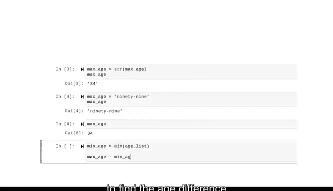

# 谷歌高阶数据分析 2：《Python入门》get-started-with-python（中英双字） - P9：09_01_01_变量与数据类型.zh_en - GPT中英字幕课程资源 - BV1Jm4y177BW

In this video， we're going to focus on variables。Variables give meaning to code。

 Think about nouns and language。 Nouns are used to identify people， places or things in a sentence。

Variables in Python are like nouns。 Vas point to values。 They're not the values themselves。

 If you have the expression， X equals 3。 X is the variable， and its stored value is 3。

The three exists in a specific location in the computer's memory。 The X points to that location。

Another way to think of a variable is like it's a container with a label on it。

 A container is a separate thing， from whatever it contains。But if I ask you to pass me the ketchup。

 you'll know which bottle to pass me， even if you can't see the ketchup inside it。

Because the bottle is labeled。Variables can store values of any data type。

A data type is an attribute that describes a piece of data based on its values。

 its programming language， or the operations it can perform。In Python， this includes strings。

 integers， floats， lists， dictionaries and more you've already encountered some of these in this course we'll explore these data types throughout the program。

When assigning a new variable， it's helpful to answer these questions before you code。

 What's the variable's name， What's the variable's type and what's the variable's starting value。

These questions help you create variable names that remain meaningful and easy to reference again later。

 Naming variables is important because these names are reminders for yourself and others about what you are storing in the variable。

Calling the data type also helps you understand what the data can and can't do。 Next。

 consider how you will assign expressions which can help make your code more concise。

An assignment describes the process of storing a value inside a variable。

 and an expression is a combination of numbers， symbols or other variables that produce a result when evaluated。

 Now， let's examine that in Python。Will translate a variable algorithm into Python code。

 Let's start with a list of the ages of the starting five players on a professional basketball team。

We'll assign the list to a variable called age list。Notice that we didn't call it， for example， X。

 because X doesn't tell us anything about the value it contains。 And if we encountered an X later。

 we might not remember that it's a list of ages。 One nice thing about Python is that the computer interprets the data type for us automatically when we assign a new variable。

 This is called dynamic typing。Dynamic typing means variables can point to objects of any data type。

Also， there are no default types for most new variables。

 So we need to assign or initialize before calling them。 Let's return to our example。

 We'll find the maximum age of the basketball players by using Pythons built in max function and passing our age list to it as an argument。

 We'll assign the result to a new variable called max age。 When we call the variable。

 the computer returns a value of 34。 This is an integer。

So the max age variable contains a value whose data type is integer。 Now。

 suppose we want the max age variable to contain a string value。

 We can convert it to string by using the string function。

 represented by S T R and reassigning the result back to the max age variable。 Now。

 our variable has a data type of string， which is indicated by the quotation marks in the output。

You'll learn more about strings later。 For now， just remember that those quotation marks are unique to strings。

We can also overwrite the contents of the variable entirely if we want。 For instance。

 we can store in it the text string 99。Now when we call the variable。

 the computer returns our new string。There are a couple of important things to note here。 First。

 notice that when we converted max age from an integer to a string， we reassigned it back to itself。

If we hadn't done this and we had simply used the string function on the max age variable。

 the computer would have returned a string， but the contents of the variable would not have changed。

Generally， when you want to modify the contents of a variable， you have to reassign it。

The second important thing to be aware of is that the order that you run your cells in matters。

 For example， if I rerun the cell where I first assign the max H variable and then call this variable in a new cell。

You'll notice that its value has reverted back to the integer 34。 It's no longer the string 99。

 In these examples， the value contained in the max age variable changed every time we reassigned it。

 That's why it's dynamic。Variables are convenient because you can refer to them instead of the values they contain。

So if we define a new variable that contains the minimum age in our list of ages。

 we can subtract the two variables to find the age difference of the oldest and the youngest player。

There is so much we can do with variables and expressions in Python。 The program asks a question。

 and the variable helps us capture the answer based on input from a specific source。

Just remember that if you want to modify the contents of a variable， you usually need to reassign it。

It's also important to consider that the order you run the cells in matters when coding in Jupiter notebook。

Soon， we'll learn about variable naming conventions and restrictions。 I'll meet you there。

