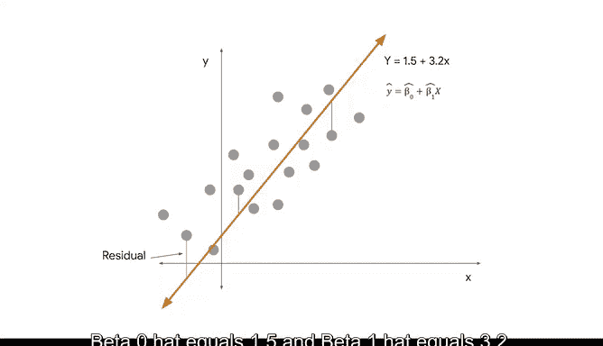

# 谷歌高阶数据分析 5：《回归分析：简化复杂数据关系》regression-analysis（中英双字） - P11：11_02_03_普通最小二乘估计.zh_en - GPT中英字幕课程资源 - BV1Ym4y1L7P7

In prior videos， we've mentioned simple linear regression。

 which is a regression technique that estimates the linear relationship between one independent variable X and one continuous dependent variable。

 Y， recall that the linear in linear regression indicates what the data looks like when plotted on an X。

 Y coordinate plane align line in simple linear regression， We're only interested in two variables。

1 X and one Y variable。😊，So the equation for a regression line is y equals intercept plus slope times x。

 which is represented as beta 0 plus beta 1 times x。

Since we'll have a number of data points for any given problem。

 there are many different lines we could draw that might fit the data。However。

 we're looking for the best fit line， the line that fits the data best by minimizing a loss function or error。

In order to find the best fit line， we need to measure error。

We can consider error as some difference between the data we have， the observed values。

 and the predicted values generated by a given model。

The predicted values are the estimated y values for each x calculated by a model。

The difference between observed or actual values and the predicted values of the regression line are what's known as a residual。

The equation for residual value is residual equals observed value minus predicted value。

Each data point has one residual。Using mathematical notation。

 the equation for the residual of an individual data point is epsilon I equals Y I minus Y I hat。

 Epsilon is a Greek letter that resembles the letter E as in E for error。

We can calculate individual residuals for each data point。

 but an important thing to note is that the sum of the residuals is always equal to zero for OLS estimators。

For some estimators， the sum of the residuals is not always equal to 0 in order to capture a summary of total error in the model。

 we square each residual and then add up the residuals for every data point。

 This is called the sum of squared residuals。The sum of squared residuals or SSR is the sum of the squared differences between each observed value and the associated predicted value。

For linear regression， we'll be using a technique called ordinaryary least squares to get our best fit line。

Ordinary least squares， also known as OLS， is a method that minimizes the sum of squared residuals to estimate parameters in a linear regression model。

Using OLS， we can calculate beta 0 hat and beta1 hat using properties of the sample data。

 recall that the hat symbol means it is an estimate of a parameter。

We will never know the exact parameter。 Remember， parameters or betas are characteristics of a population。

 since we will only ever have sample data， our goal is to get a reasonable estimate of the parameter。

Let's say that we have a certain sample of data， and we now want to determine a line that fits the data。

 Well for our first attempt at a best fit line， the slope is one， and the intercept is 2。5。

To calculate the sum of squared residuals， first， we calculate the predicted values for each x。Next。

 we can find the residual for every observed value of X on the graph。 we've plotted the residuals。

 The residuals are the difference between each observed value and what the line predicted。

 So this line is okay。 But let's try to get a little bit closer to the points。

 Let's try another line。 This time， we'll set the slope equal to 1。25 and the intercept equal to 3。

 Again， we have to plot the residuals and calculate the sum of squared residuals from the graph。

 it seems we're getting closer， but it's hard to tell if we've got the best line。

 We could just keep trying different lines。 And through trial and error。

 pick a line that we think is closest to the data points。😊，But that's very time consuming。

The good news is that in Python， the computer will use OLS or the ordinaryary least squares estimation technique to test out many lines and identify which one is the best fit line。

😊，With OLS estimation， we find that beta 0 hat equals 1。5 and beta 1 hat equals 3。2。

The lines we're estimating represent the best fit of the model to the data。Later。

 we'll talk about uncertainty using P values and confidence intervals to aid in the interpretation of results。

Now that we've covered what simple linear regression is。

 we'll go back to pace in our regression analysis framework。

 we'll examine the model assumptions that the data needs to follow for us to use this cool new tool in our regression toolbox。

