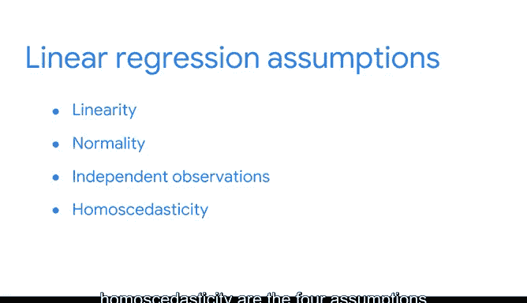

# 谷歌高阶数据分析 5：《回归分析：简化复杂数据关系》regression-analysis（中英双字） - P12：12_02_01_建立线性回归假设.zh_en - GPT中英字幕课程资源 - BV1Ym4y1L7P7

All right， let's begin with the analyze stage of the pace framework。

 The first task in simple linear regression analysis is checking the assumptions of the model。

 In addition to the technical needs of the model， you'll need to consider the business context of the problem you're working on。

 This will come in the plan stage。 previously， I spoke about model assumptions as statements about the data that must be true。

 in order to justify the use of a particular modeling technique。

Ensuring that we're using the right model， given the data that we have。

 allows us to be confident in the results those models produce。

Think of model assumptions as the bridge between the analyze and construct phase of the pace framework。

In other words， examine the assumptions before the construct phase when possible。

Certain assumptions can only be checked after model construction。

 so make sure you check those assumptions after you apply the model to confirm if the model is valid or not。

Data visualizations can be used as a tool to determine if model assumptions are met Thankly。

 Python will help you tremendously with generating these and I'll be here to guide you through it all too。

😊，There are four key assumptions of a simple linear regression， linearity， normality。

 independent observations and homoseasticity。 For now。

 we'll focus on understanding what each of these assumptions mean and how they are checked using data visualizations。

😊，The first assumption of a linear regression just so happens to be the simplest to check for。

 the linearity assumption。You already know that the linear in linear regression comes from the way the data looks when plotted on an XY coordinate plane。

 a line。To detect if this assumption is met， you just have to make sure that the points on the plot appear to fall along a straight line。

 If the visualization looks like a random cloud or resembles a curve rather than a line。

 Then the assumption is considered invalidated， meaning that this model does not fit the data well。

 You might need a different or a more complicated model for this data set。 In contrast。

 a scatter plot that shows the data points clustering around a line indicates the linear regression would be an appropriate model to represent the relationship between X and Y。

Next up on the checklist is the normality assumption。

 This assumes that the residual values or errors are normally distributed。

Since this assumption is about residuals， you can check the assumption until after the model is built。

 but once the model is built， you can create a specific plot called a quantile quantile or QQ plot of the residuals。

If the points on the plot appear to form a straight diagonal line。

 then you can assume normality and check this assumption off the list。

Next is the Independ observation assumption， which states that each observation in the data is independent。

Here it is helpful to use contextual information about data collection and the variables used to determine if this is true。

If the assumption is met， we would expect a scatter plot of the fitted values versus residuals to resemble a random cloud of data points。

If there are any patterns， then we might need to reexamine the data。Last but not least。

 the Homoseity assumption is fourth on the list。This one sounds complicated。

 but knowing the literal meaning of the term helps Homoceasticity means having the same scatter。

Scatter plots come to the rescue once again when checking Fmoaasticity。

Returning to the scatter plot of fitted values versus residuals。

 there should be constant variance along the values of the dependent variable。

 This assumption is true if you notice no clear pattern in the scatter plot。

Sometimes you'll hear this described as a random cloud of data points， but for example。

 if you observe a cone shape pattern， then the assumption is invalid。Liinearity， normality。

 independent observations and homoceasticity are the four assumptions of a simple linear regression。

 Before moving ahead， don't feel like you need to memorize all of this material right now。 Remember。

 data analysis is an iterative process。 You can go back to these concepts。

 Check to see how the assumptions align with your data and then move forward with the regression process。

 You will have plenty of opportunities to practice and hone your skills throughout this course。 Now。

 let's apply everything you've learned here and try it out on a data set using Python。😊。

