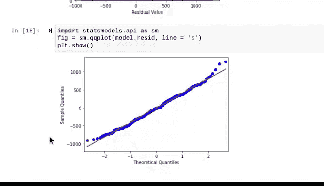

# 谷歌高阶数据分析 5：《回归分析：简化复杂数据关系》regression-analysis（中英双字） - P13：13_02_03_使用Python探索线性回归.zh_en - GPT中英字幕课程资源 - BV1Ym4y1L7P7

Are you ready to start practicing your computer programming skills now， in this video。

 we'll apply some of the concepts around simple， linear regression to data。

The move from theory to application is a big milestone。

 but remember that you have worked hard to get to this point。

We'll go through the code in some depth today。 You will have access to the code for you to review in detail。

 Let's begin by exploring a problem that's been affecting a local zoo where you were recently hired as part of the analytics team。

The caretakers who manage the penguin habitats are having trouble keeping their population adequately fed。

 Theyre hoping to find out if certain features of the birds are related to body mass to better manage their feeding routines。

The dataset set includes structural measurements of different penguins。

 such as Bill length and body mass。 Now that you have some context。

 you can use exploratory data analysis to start analyzing the data。 First， import some packages。

 pandas and Seaborn。 both will be especially useful today。

 So the amazing thing about Seaborn and many other libraries in Python and other programming languages。

 I that there are built in data sets that you can work with。

 You don't even need to download any files。 Now， load the penguin data set and save it as a variable called penguins。

😊，The low data set function returns a data frame， so penguins is a data frame。

Now that you can access the data， use the head function to examine the first couple of rows。

There are a few continuous variables， bill length， bill depth， and flipper length。

 all measured in millimeters。Body mass is measured in grams。 There are also a few discrete variables。

 species， island and sex。Since you're working with simple linear regression。

 you'll focus on the continuous variables。If you would like to。

 you can access the code to see how I clean the data。

 I subset the data to include only two species of penguin and dropped a couple of rows with missing data。

Now you can start creating plots to identify some linear relationships between the continuous variables the clean data is saved in a data frame called Penguin's underscore final。

Now you can input the data frame into Cborn's pair plot function。

Sbornne's pe plot function creates a scatter plot matrix。

 A scatter plot matrix is a series of scatter plots that show the relationship between pairs of variables。

😊，By using the pair plot function， you will observe a few linear relationships in the scatter plots。

The diagonal displays the distribution of the continuous variables。

 This assures you that the data has met the linearity assumption for building a simple。

 linear regression。First， bill length and body mass seem to be positively correlated。 Next。

 Fper length and bill length also seem to be positively correlated。 Lastly。

 body mass and flipper length also seem to be correlated。

Let's explore the relationship between bill length and body mass further in terms of linear regression assumptions。

We know we have met the first linear regression assumption of linearity。Luckily。

 the diagonal of the pair plots also shows us the distribution of each variable。

 We can observe that both bill， length and body mass are close to being normally distributed。

 This suggests that we'll probably have normally distributed residuals。

 The third assumption is of independent observations。Since each row has data on a different penguin。

 we have no reason to believe that one penguin's bill length or body mass is related to any other penguins。

We can confirm the last assumption， homocaacity after we build our model when we graph the residuals。

 Now， let's subset the data once more to isolate bill length and body mass。😊。

Note the use of double squared brackets， which tells Python which columns you want to choose。

Write out the regression formula in terms the computer can understand。

 and you'll save it as a variable called formula。As you do this。

 pay careful attention to the column names， you need to specify the column names exactly so the computer knows how to run the regression model。

First， type the Y variable column name， which is body underscore mass underscore G。A space。

 and then ailda， another space and the X variable column name， which is Bill underscore length。

 underscore M M。The Tilde lets the computer know that whatever comes after is our X variable。

The spaces are not necessary， but can be helpful for clarity。

Now that you have the data and the formula， you can create an OLS object using the OLS function from the Stats model module。

Save the object as a variable called OLS。Input the OLS formula variable as the formula argument of the OLS function。

Then input OLS data variable as the data argument。Next。

 you'll use the OLS Object Fi method to actually fit your linear regression model to the data。

Save the results as a variable called model。Finally。

 print out the result of the ordinary least squares estimation。

 which is the technique the OLS function used to build the linear regression model。

 then use the model's summary method which will print out a table of many different statistics。

This table contains lots of information。 We'll go through some different sections of the table later in this course and leave the rest for you to explore on your own For now。

 we'll focus on the bottom section， which details the coefficients the model determined would generate the best fit line。

 Since we're using a simple linear regression model， we have two coefficients。

 an intercept or beta 0 and a slope or beta 1。You can find the Y intercept of the best fit line in the intercept row of the coefficient column。

 which is abbreviated to COEF in the table。In this case， it's negative 1707。2919。

You can find the slope in the building row of the coefficient column。

The slope of the bestfi line is 141。1904。Let's rewrite this as a linear equation。

 which will help us interpret the results later。Begin by plugging the variables into the linear equation。

 y equals intercept plus slope times x。Y is the penguins body massing grams。

 x is the penguin's bill length and millimeters。Next。

 the model will just calculate the intercept and slope。

Round both to the nearest 1 hundredth or two decimal places。

This means that penguin with one millimeter longer bill length has 141。

19 gram higher body mass on average。Remember， you still need to examine some assumptions about the residuals to double check the conclusion。

Great， you have fit a linear regression model to the data to finish checking the model's assumptions。

 calculate some fitted values using your model's predict method。

 Then you can access the residuals using the model variable。😊，By residuals。

 we mean the difference between the actual and fitted values using the model's Re attribute。Finally。

 create a couple of plots to confirm your findings。

 use the Seaborn's Regg plotot function to plot the data with the best fit regression line。

You can observe a linear relationship between the variables， the best fit line。

 and a small shaded region around the line indicating the uncertainty around the model estimates。

Returning to the linear regression assumptions， create a scatter plot of the fitted values against the residuals。

This is a very common plot you'll encounter when working with linear regression to check various assumptions。

From this plot， you can observe that residuals seem randomly space。

 which means you can assume homoidacasticity。A random looking scatter plot is indicative that the independence assumption is not violated。

 but it's not the sole reason that we believe it to be true。

You could examine inputs and other more advanced statistical tests to confirm this。Lastly。

 create a histogram of our residuals to determine if the residuals are normally distributed。

 If the residuals are normally distributed following that classic bell curved shape。

 then you can confirm the normality assumption has been met as well。

The residuals are a little bit skewed in the histogram。

 so you can create a QQ plot to verify normality。You can use the stats model QQ plot function to create the graph。

There is a straight diagonal line trending upward with some slight curvature on the extremes。

You may want to explore this further， but for now， this is pretty good confirmation of the normality assumption。

Now that you have confirmed all the assumptions are met。

 you can say that the results from the regression model are likely reasonable。

Wow， we went through a lot of code and many plots together。

 You should be so proud of what you've accomplished in this video。

 Keep in mind that you can always review what we've covered， along with the code and documentation。

 Great work。😊。