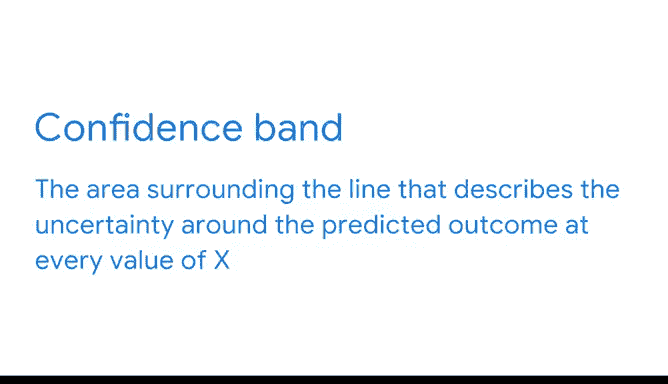

# 谷歌高阶数据分析 5：《回归分析：简化复杂数据关系》regression-analysis（中英双字） - P14：14_02_01_评估回归分析中的不确定性.zh_en - GPT中英字幕课程资源 - BV1Ym4y1L7P7

So far， we've used PA to think like a data professional as we address the pguin problem at our local zoo。

We planned by thinking through the problem and subsetting the available data appropriately。

 how can we better understand the relationship between penguin anatomy and their body mass？

In the analyze stage， we performed EDA and checked model assumptions。

Then moving on to the construct stage， as a reminder， there are two parts。

We built our model and were able to pull out some parameter estimates。

Now we're going to focus on the next step of the construct phase， model evaluation。

Model evaluation is an important practice in data analysis careful evaluation and interpretation of your regression model helps you understand its performance and accuracy。

😊，To start， let's revisit the results from our regression model。 based on the summary of results。

 you know that OL S has determined that the best fit line has an intercept of negative 1707。

29 and a slope of 141。19。But randomness and unpredictability are characteristics of every regression model that make it difficult to predict outcomes with 100% certainty。

After all， there is still a difference between our observed and predicted values。

You've just found the model that you are most certain about。

To explore the notion of uncertainty further， let's turn our attention to the rest of the OLS summaryum table rows about the intercept and bill length。

There is a column labeled P greater than the absolute value of T。

This indicates the P value associated with the coefficient estimates。

The two columns to the right of the P value column indicate a 95% confidence interval around the coefficient estimates。

When evaluating simple linear regression results， you'll focus less on the intercept row and more on the row involving your independent variables of interest。

In this case， that's billing。So you can say that the coefficient estimates for Bill length is 141。19。

 with a P value of 0。000， and a confidence interval from 131。788 to 150。592。Previously。

 when you learn about hypothesis tests， confidence intervals were defined as a range of values that describe the uncertainty surrounding an estimate。

 In the case of linear regression， we are estimating parameters。

 So a 95% confidence interval means that interval has a 95% chance of containing the true parameter value of the slope。

😊，What if the slope and intercept were slightly different？Well。

 let's draw out a few different lines on our plot with slightly different slopes and intercepts all within our confidence intervals。

We get a region around the regression line that is tight around the center and fans out a bit towards either end of the line。

 This shape may appear familiar。 You plotted it previously using Seaborne's re plot function。

 These lines make up the shaded region that was around the regression line。Essentially。

 the confidence interval around the parameter estimates reveal what we call a confidence band。

 A confidence band is the area surrounding the line that describes the uncertainty around the predicted outcomes at every value of x typically expressed as a shaded region around the best fit line on a scatter plot。

 A confidence band reveals the confidence interval for each point on a regression line。

 confidence bands are simply another way to report your findings responsibly。

Simple linear regression is a powerful addition to any data professionals toolbox whether you are analyzing the financial impact of price increases to a streaming service or you're forecasting sales for a fashion boutique regression analysis can help you make discoveries and understand the relationship behind the data。

But we must remember， data is noisy and results can be uncertain when using regression models like simple linear regression。

 even the best data doesn't tell a complete story。As a data analytics professional。

 you should always aim not only to evaluate the performance and accuracy of your models。

 but also to report uncertainty， Communicating about confidence intervals and confidence bands is part of being a responsible data professional。

 These metrics will also help you understand how well the models can tell the story behind the data。

