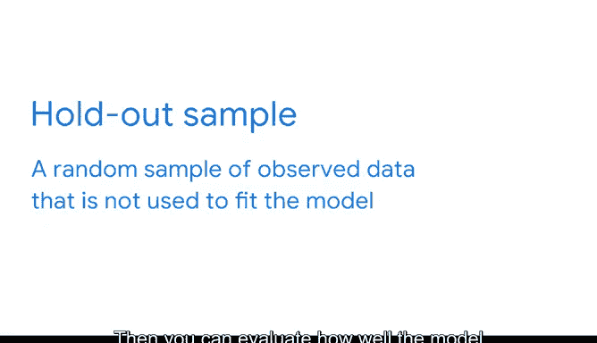

# 谷歌高阶数据分析 5：《回归分析：简化复杂数据关系》regression-analysis（中英双字） - P15：15_02_03_模型评估指标.zh_en - GPT中英字幕课程资源 - BV1Ym4y1L7P7

Up to this point， we've progressed through the plan and analyze phases of the pace framework for regression modeling。

 We've even started the construct phase by actually building a linear regression model。

I'm excited to continue guiding you through model evaluation。

 we're getting so close to the execute phase where you share the stories behind the data you're studying。

Using a variety of evaluation metrics supports data professionals confidence in the insights produced by their analysis。

 These metrics are key to responsible communication of results。If models are inaccurate or imprecise。

 decisions made based on those insights may also be inaccurate。

3 metrics you might encounter are R squared mean squared error， also called M。

 E and mean absolute error or M A E。The main metric that academics， researchers。

 and data professionals use when evaluating regression models is called the coefficient of determination or R squared。

So that's what we'll focus on。You may have noticed that in the output from OLS model you previously built。

 there was a part of the output labeled R squared this is what we're talking about。

R squared or the coefficient of determination measures the proportion of variation in the dependent variable y。

 explained by the independent variables x。To explain this metric more thoroughly。

 let's think through the example about penguins and linear regression again。

You've identified a linear relationship between the penguin's bill length in millimeters and the penguin's body mass in grams。

Based on your regression analysis， you found the best fit line。

 body mass and grams equals negative 1707。30 plus 141。19 times bill length。

But the data points just cluster around this best fit line。

Many of the data points are actually not on the line。

 this means that bill length only accounts for some of the changes in body mass。

R squared helps data professionals determine how much of the variation in the X variable explains the variation in the Y variable。

At most， R squared can equal 1， which would mean that x explains 100% of the variance in y。

 If r squared equals 0， then that would mean x explains 0% of the variance in y。

The O L S summary table shows the model has an R squared of 0。769。

 This means that Bill length explains about 77% of the variance in body mass。

There is still about 23 per cent of the variance of body mass that is unexplained by the model。

 This variance might be due to other factors or natural unexplained differences from penguin to becoin。

There is no benchmark value that r squared has to equal， but in general， the higher r squared。

 the better because it adds validity to any recommendation you make based on your analysis。

R squared is a useful metric that can help you evaluate your model。

 but there are also processes that help strengthen the evaluation of a model。Typically。

 when we have a data set， we use at least part of the data to build and test the regression model。

 The computer uses the data to calculate a measure of difference between the actual and predicted values。

 such as sum of squared residuals。Then based on the computer's calculations。

 it can find the best line。But sometimes we want our model to be good at generating predictions for data we haven't collected or that doesn't exist yet。

 For example， let's return to the penguins at the local zoo。

 They welcomed a new group of penguins to their flightless bird habitat。

 It would be helpful to have a sense of how the new penguins structural measurements relates to their body mass。

So in those cases， we want to know how the model we built performs on the data it learned from and how the model performs on data it hasn't experienced yet。

In this case， we'll need to save a holdout sample before we build the model。

 A holdout sample is a random sample of observed data that is not used to fit the model。

 Then you can evaluate how well the model fits the data used to build the model。

 and you can evaluate how well the model fits the holdout sample。

We've covered a lot of different ways you might evaluate linear regression model。

 R squared and hold out samples will serve you in many cases。

 allowing you to confidently share the insights you've discovered。

 I'm excited to discuss the execute phase and how to communicate model findings soon。😊。

