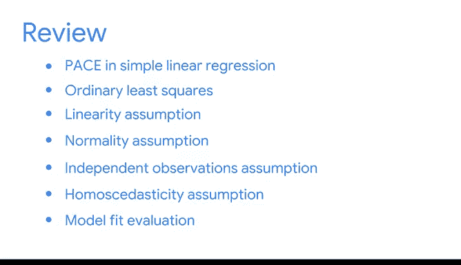

# 谷歌高阶数据分析 5：《回归分析：简化复杂数据关系》regression-analysis（中英双字） - P17：17_02_01_总结_2.zh_en - GPT中英字幕课程资源 - BV1Ym4y1L7P7

Well done。 you've come a long way and you built your very first regression model。

 I'm so thrilled to continue your regression journey with you Before we wrap up。

 let's recap what you've added to your data toolkit。

Linear regression analysis is a foundational data science technique by now you're familiar with PA。

 plan， analyze， construct and execute in linear regression analysis。

You had an opportunity to use ordinary least squares estimation in Python。

 you use OLS to get the best fit line that minimizes the error between predicted and actual values。

Next， you learn the four main model assumptions of simple linear regression， linearity。

 normality of residuals， independent observations and homoidasticity。

 you had some practice applying EDA and Python to check whether linear regression is appropriate based on meeting these assumptions。

You built a model in Python and you learned how to evaluate model fit using R squared。

 hold out samples and measures of uncertainty like confidence intervals and P values。

Lastly， you turn numbers and statistics into a story。

 you explored a penguin data set to show how a data analytics professional can present findings to others in clear。

 simple terms。You learn the value of producing visualizations in Python to communicate these results of your simple linear regression model to stakeholders。

 a valuable skill that you'll be able to use throughout your data analysis journey。

I'm proud of how far you've come along and you should be too。

 so far we've gone through all of pace and simple linear regression。

While we completed the circuit once， it doesn't stop there。Next。

 we'll extend our knowledge of simple linear regression to multiple linear regression models。

 Sple linear regression is great for tackling problems with a single independent variable。 However。

 the more complex the problem， the more variables can influence what's going on。

 That's where multiple linear regression becomes useful。

 You're making amazing progress and are on your way as a future data analytics professional。😊。

