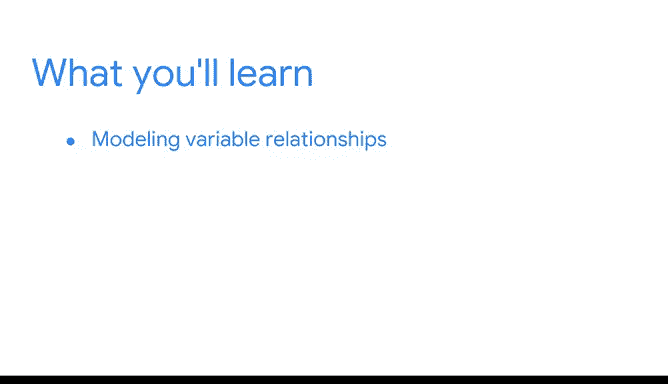

# 谷歌高阶数据分析 5：《回归分析：简化复杂数据关系》regression-analysis（中英双字） - P1：01_01_01_课程介绍-5.zh_en - GPT中英字幕课程资源 - BV1Ym4y1L7P7

Hi， welcome back to the next steps of your journey as a data professional。

 I'm so excited to join you。 We'll be discussing regression models and more hypothesis testing so that you can explore the relationships in your data。

😊，The tools we learn about together will allow you to uncover powerful insights about your data。

 tell compelling stories and influence decisions and strategy making。

The modeling fundamentals we explore in this course will give you an even stronger foundation to pursue entry level jobs in the data career space and to tackle more advanced topics in the future。

 like machine learning。I'm eager for us to connect all the pieces you've learned so far。

You've come a long way since the start of your data journey。

 from the foundations of data science and Python fundamentals to exploratory data analysis and statistics。

 you learn so much about the data landscape。Together we'll be applying your current skills to your first model。

 regressionions。My name is Tiffany， I'm a marketing science lead and I work at the intersection of data science and marketing here at Google。

As a child， I gravitated towards math probably because it was my favorite subject。

When I got to college， I was not exactly sure what I wanted to major in。

 but I was drawn towards quantitative fields。As many of you may have also experienced。

 I didn't love my first decision and had the opportunity to try out a few majors。

 exposing me to the variety of analytical career opportunities。Fast forward to my career。

 I've held positions in finance， statistical research and data science consulting before joining Google。

I've worked with a variety of data， including patent， fraud， hardware sales， and now marketing data。

The great thing about being a data professional is that it's in high demand in most industries。

 which means that you can find interesting problems to solve across a huge variety of companies。

 products， and countries。I love the flexibility to find the right fit for me while also knowing that I will be able to deliver value to whatever team I'm on。

I've learned so much in my career， and I'm excited to share my experience with you In this course。

 we will talk about modeling relationships between variables。 To do this。

 we will focus on regression analysis。 regression analysis or regression models are a group of statistical techniques that use existing data to estimate the relationship between a single dependent variable and one or more independent variables。

 We will unpack this definition together later in this program。

 The techniques we learn in this course will help you answer any number of questions with actionable steps to achieve your organization goals。

😊，For example， regression models can help you understand what variables impact sales。

They can also help you understand the factors that lead a customer to subscribe to a newsletter。

Regression models can even help you understand why a user keeps scrolling on a company's website。

As we work through the course together， we'll continue discussing the role data professionals play in making responsible decisions。

 from data handling to modeling。No matter how good a potential data story is。

 how we arrive at our story is the priority in being honest and effective storytellers。

Python programming will be critical to running and testing complex models， visualizing data。

 and communicating results。Riggorous exploratory data analysis or EDA will inform which models we choose and how we approach the modeling process。

Statistics will play a major role in helping us understand how our models work and will allow us to present actionable results to stakeholders。

Our statistics toolkit will allow us to build the models we talk about regressionion analysis is a relevant and marketable skill。

 regressionion models are flexible so you can design them based on the data that you have。

 Additionally， regression model results offer opportunities for interpretation and communication。

Data professionals can provide insights from these models that align clearly with actionable steps。

For example， we're able to build regression models to identify what actions on a website are indicative of high value customers。

 For instance， there is a high likelihood that customers who visit the sale page。

 watch a video or sign up for emails are customers who will make multiple purchases in a year。

Some of these indicators may seem obvious， but having a regression analysis that identifies and quantifies the relationship is powerful。

 We're able to use the information in marketing campaigns to attract new customers。 Together。

 we'll be exploring regression analysis as the basis of a solid foundation for building more complex machine learning models。

😊，I'm so excited to show you each of the tools in your regression toolkit。😊。

You'll get a lot of practice in Python。 We'll explain how to determine if a model is appropriate for the data。

 how to run the model， and how to understand the computer's results。

We're also going to discuss some math and review the concepts step by step the whole time。

You can also review course resources whenever you want I'm so excited to get started on regressions so let's begin。

