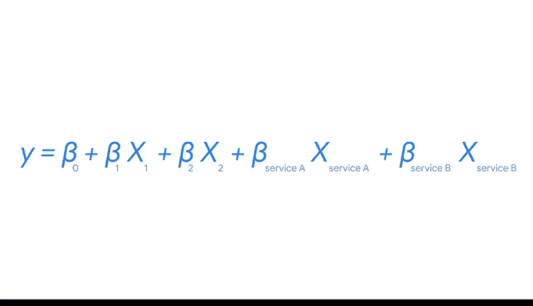

# 谷歌高阶数据分析 5：《回归分析：简化复杂数据关系》regression-analysis（中英双字） - P20：20_03_01_表示分类变量.zh_en - GPT中英字幕课程资源 - BV1Ym4y1L7P7

As a data analytics professional， you might encounter scenarios in which are interested in variables that are not continuous。

 They could be categorical。 For example， in the case of website clicks and advertisements。

 some ads are black and white and some ads are all in color。

 or maybe some ads have a call to action while other ads don't。

 or perhaps some product ads are on different streaming services。

These are all categorical variables that could be related to how many clicks the website receives。

In the case where we have a categorical independent variable。

 we have to represent the categories as numbers for the computer to understand the data。

 there are two main ways to handle categorical data。

 one hot encoding and label encoding in this video we will learn about one hot encoding。

One hott encoding is a data transformation technique that turns one categorical variable into several binary variables。

Let's take the example of an advertisement having a call to action or not。

 We would create a new variable in the data， let's call it action and mathematically we'll denote it as X action。

 If an advertisement has a call to action， then X action equals one。

 If an advertisement commercial does not have a call to action， then X action equals0。

Our equation would become y equals beta 0 plus beta 1 times x1 plus beta 2 times x2 plus beta action times x action。

X1 measures the number of people in the advertisement。

 and X2 measures the length of the advertisement。 Now。

 let's assume that we have two advertisements where X1 and X2 are the same。

 but one has a call to action and one doesn't。We can then assume that the advertisement with the call to action had beta action more website clicks than the advertisement without a call to action。

Now let's remove the call to action variable， What if we are interested in which streaming platform the a is on。

 let's say the company is running ads on three services， A， B and C。

Let's also assume that ads can only run on one platform at a time， so if an ad is on service A。

 it's not on service B or C。Now we have a categorical X variable that has three possibilities。

 Let's figure out how to represent it mathematically to represent two possibilities has a call to action versus does not have a call to action。

 we use one binary variable in order to represent three possibilities， we need two binary variables。

 Let's examine why this works。 let's imagine we have a binary variable。 X service A。

 If X service A equals1。 we know that the advertisement is playing on service A。

 but we also know two other pieces of information。 If the ad plays on service A。

 then it is not playing on service B。 and the ad is also not playing on service C。

 If X service A equals0， we only know that advertisement is not on streaming service。

 The advertisement could play on either service B or C。Since we have missing information。

 we need another binary variable to help us and the computer figure it out。

 let's add a variable X service B。If X service A equals 1， we already have all of our information。

 we know that the ad plays on service A， so X service B must equal0。

The ad does not play on service B， and we also know it does not play on service C。

But if x service A equals zero， we can learn more information from X service B。

If x service B equals1， then we know that the ad plays on service B。 In turn。

 we know that the ad does not play on service C。Lastly。

 if x service A equals0 and x service B also equals0。

 then we know the ad plays on neither service A nor service B， so the ad must play on service C。

Now we have all the information we need with just two variables。

So let's revise the equation one more time， we have y equals beta 0 plus beta 1 times x1 plus beta 2 times x2 plus beta service A times x service A plus beta service B times x service B。

Now that the equation is written out， you'll notice there is no variable Xserv C because it would not provide us with more information。

But the interpretation is a little bit different。We can think of service C as the default streaming service。

 so beta service A is the difference in website clicks for two advertisements that are the exact same except one ad is played on service C and one is played on service A。

 similarly， beta service B is the difference in website clicks for two advertisements that are the exact same except one ad is played on service C and one is played on service B。

In this video， you learn how one hot encoding allows us to turn one categorical variable into several binary variables。

Now we can start estimating how many clicks the website will get based on variables about the ad So we'll go over how to use Python to one hot and code categorical variables we will revisit pace and regression modeling through model assumptions。

 model construction， model evaluation， and model interpretation together。Great work so far。

 I can't wait to join you in the next video。

