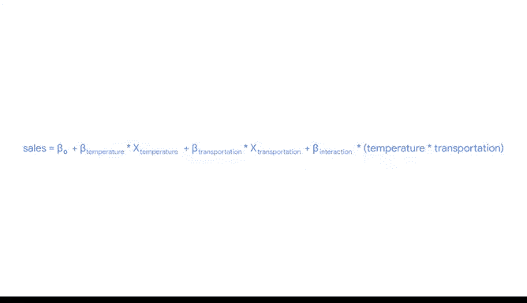

# 谷歌高阶数据分析 5：《回归分析：简化复杂数据关系》regression-analysis（中英双字） - P22：22_03_01_解释多元回归系数.zh_en - GPT中英字幕课程资源 - BV1Ym4y1L7P7

We've already interpreted the results of simple linear regression before。 For example。

 if we plot some data about temperature and ice coffee sales。

 the scatter plot will show us a series of points in a diagonal line trending upward。

We are able to interpret the results relatively simply。In this video。

 we'll go step by step through the process of building a multiple regression model and then interpreting the results。

As an example， let's say the data follows this equation。 Sal equals negative 44 plus 2。

2 times temperature。 We can say that a  one degree increase in temperature is associated with 2。

2 more ice coffee sales。 This is great and probably explains a large amount of why ice coffee sales vary on any given day。

😊，But there are other factors involved， and if you work for a large coffee company。

 you might be interested in exploring factors under your control， you can't change the temperature。

 but you can be strategic about where you build your store or whether or not you have an ad on a nearby building。

Thankfully we're learning about multiple linear regression now， so as a data analytics professional。

 you can help your coffee company answer these questions so let's add one more variable to the equation Is there an ad near the store。

Let's revise the equation accordingly， Sal equals beta 0 plus beta temperature times x temperature plus beta add times x add。

The add variable is a binary variable， there are two possible scenarios when there is an ad nearby and when there isn't an ad nearby。

If there is an ad posted nearby， then X add equals1， and the temperature will take on some value。

 let's say it's 75 degreesFahrenit。So the equation becomes sales equals beta0 plus beta of temperature times 75 plus beta add times 1。

We estimate that the presence of the ad is associated with some increase in sales。

Now let's take the same temperature and say that there isn't an ad nearby。

 the equation then becomes sales equals beta 0 plus beta temperature times 75 plus beta add times 0 simplifying this equation we get beta 0 plus beta temperature times 75。

The beta add terms drops out because it's multiplied by zero， when there isn't an ad。

 then the sales are only a function of the temperature。

Now let's remove the addd variable and introduce the question of proximity to public transportation。

The variable transportation will measure how many kilometers away a given coffee shop is to a bus train or subway stop The equation becomes sales equals beta0 plus beta temperature times x temperature plus beta transportation times x transportation where temperature and distance to transportation are continuous variables。

For every one degree increase in the temperature， while holding distance to public transportation constant。

 we expect ice coffee sales to increase by beta temperature。

For every one kilometer further a stores from public transportation。

 while holding temperature constant， we expect ice coffee sales to decrease by beta transportation。

Note that we have to hold the other variable constant when interpreting the results。

The math will explain why。Now we've gone over what to do when we have several standalone variables。

But there are cases when we might expect two variables to interact。 For example。

 in the case of temperature and distance of transportation， we might expect that if it's cooler。

 distance of transportation might have a different effect。

 If we want to account for how two variables， values affect each other。

 we include an interaction term。An interaction term represents how the relationship between two independent variables is associated with changes in the mean of the dependent variable Typ we represent an interaction term as the product of the two independent variables in question。

Going back to the example of coffee shop sales， if we suspect that distance from transportation might be associated with different changes in coffee shop sales based on the temperature。

 we can include the interaction term temperature times transportation。

Originally we said that sales equals beta0 plus beta temperature times x temperature plus beta transportation times x transportation。

If we want to include the interaction between temperature and transportation。

 we can revise the equation to B sales equals beta0 plus beta temperature times x temperature plus beta transportation times x transportation plus beta interaction times the interaction between temperature and transportation。

The interaction is represented with a multiplication symbol。

In this example， we took into consideration the interaction between independent variables using the interaction term。

 we'll continue to learn how to interpret the nuances of regression and coefficients in this course。

We've covered a lot so far and practice will help you build confidence in these concepts。

 spend time connecting the resources available in this course to help you use multiple regression。

 interpret the results and tell the data story Next we'll keep digging into multiple regression。

