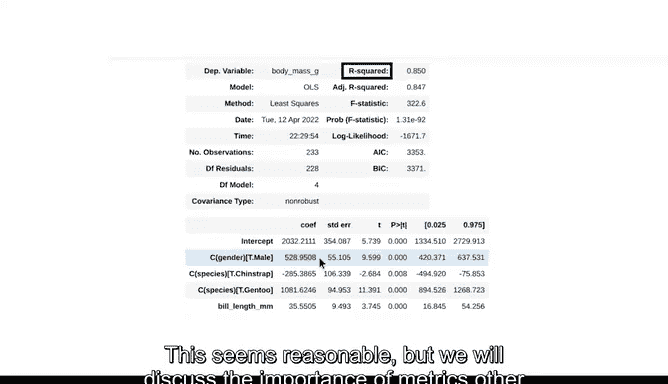

# 谷歌高阶数据分析 5：《回归分析：简化复杂数据关系》regression-analysis（中英双字） - P23：23_03_02_使用Python解释多元回归结果.zh_en - GPT中英字幕课程资源 - BV1Ym4y1L7P7

We explored some interesting and more complex questions that multiple regression can help us answer。

 We went through an overview of how to interpret multiple regression models。 Now。

 let's turn to Python。😊，Just like with simple linear regression。

 we'll find the best fit line by minimizing the sum of squared residuals。

 which is a measure of error。 While we could spend a lot of time performing ordinary least squares estimation one step at a time。

 Python has some built in functions that help us build models。 This way。

 we can spend our time as data analytics professionals exploring the data and communicating insights from the calculations。

 We're going to revisit the penguins data set from earlier to see if we can learn more about the penguins body mass。

 We've already done some exploratory data analysis and data cleaning and save data as a variable called penguins。

😊，Get a quick summary of the data using the pandas head function。

 There are four different variables in the dataset set， body mass and grams。

 Bill length and millimeters， gender and species。😊，The data is relatively clean for this problem。

 you'll try to predict body mass based on the other variables。Next。

 divide the data into the independent variables or x's and the dependent variable Y This step helps prepare the data for the function you'll use to create training and hold out data sets。

Use the train test split function from the Psyit Learn library to create a training dataset set and a holdout or testing dataset first import the function。

Now use the prepared data to divide the data into training and holdout data sets。

 Note that the test size variable is the proportion of data you're randomly assigning to the holdout data set。

In this case， you're holding back 30% of the data to test the model， depending on the context。

 it may be appropriate to hold back more or less of the data。

The random state variable does not have to be set， but you are assigning it the value of 42 so that you can replicate our results。

 You'll encounter the number 42 frequently in code documentation。

 The number 42 is a significant number in a popular science fiction novel and has been adopted by the computer science community。

If you put in a different value for the random state variable， you'll get different results。

It does not matter what number you put， but setting the random state allows someone else to replicate your work。

Next， we need to think about our multiple regression formula。

 Our independent variables are Bill length， gender and species。

Will'll use the stats models module to run the regression， like you did for simple linear regression。

The stats model's ordinary least squared function， OL S needs to know your regression formula。

Save it as a variable。O L S underscore formula equals body mass， Tilda。

 Bill length plus gender plus species。 Note that we added capital C and parentheses around gender and species。

 The notation lets stats models O L S function know that gender and species are categorical variables。

 The function will then encode the variables。If you haven't already imported the OLS function。

 do so with the following line of code。The data was saved already as a data frame called OLS data。

 You can input your formula and the data frame into the OLS function。 Lastly。

 use the OLS objects fit method to actually fit the model to the data。

One of the benefits of using stats models， O L S function is that it provides us with a compact summary table of relevant statistics。

 We can easily find the coefficients， standard errors， T statistics。

 P values and confidence intervals for each independent variable。😊。

These values let us interpret the regression results quickly and easily。

Access the OLS summary table using the summary function。

Let's explore the male variable under the column for the coefficient。

 there is a row labeled C parentheses male。😊，The way the variable was encoded was male is  one。

 and female is 0。 This means that the baseline or reference point is female penguins。

 So the coefficient indicates how much body mass would differ between two penguins that only differ in gender。

Assuming the male and female penguins are the same species and have the same building。

 We expect the male penguin's body mass to be about 528。95 G more than the female penguin。

 The P value is very small。 So this coefficient is statistically significant。

Now let's consider the row for billlink。Assuming that two penguins are the same gender and species。

 if the bill length increases by1 millm， we would expect the penguin with the longer bill to be about 35。

55 grams larger in body mass。The P value is very small， so the estimate is statistically significant。

The O L S summary table also gives you model evaluation metrics like R squared。 The R squared is 0。

85， indicating that your model explains about 85% of the variance in body mass。

 This seems reasonable， but we will discuss the importance of metrics other than R squared when working with multiple linear regression later。

😊。

You know how to fit the model to the data and get a summary table of statistics。

 And you explore the coefficients and P values。 There's a lot more in the table so you can investigate any of the metrics we have not covered yet in this course。

 I encourage you to peruse the readings in this lesson and try out the code on your own。

 All of these statistics form the basis for interpreting results and communicating with stakeholders。

 Great work so far。 I'll join you again next time。😊。

