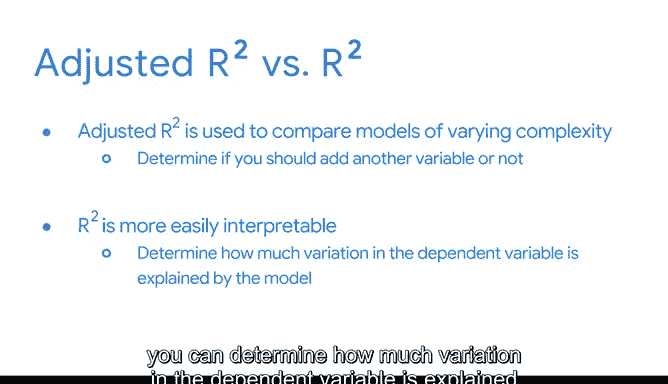

# 谷歌高阶数据分析 5：《回归分析：简化复杂数据关系》regression-analysis（中英双字） - P24：24_03_01_过拟合问题.zh_en - GPT中英字幕课程资源 - BV1Ym4y1L7P7

So far， we've extended simple linear regression to multiple regression。

 which is a powerful tool because it allows us to answer a wide variety of questions。

 Whenever we're estimating a continuous variable by using several different independent variables。

 multiple regression is a good first step。😊，But every tool has its limitations。

 When we first discuss simple linear regression， we focused on R squared as the most common metric for evaluating linear regression。

To recap r squared is the proportion of variance of the dependent variable y。

 explained by the independent variable or variables x。

This seems like a reasonable and highly interpretable metric for determining how good of a linear regression model you have。

 If you recall， when we examine the output of multiple regression model。

 R squared with still one of the metrics listed。😊，But when we started adding more independent variables into the equation。

 r squared gets more complicated。Whenever you add another independent variable to a multiple regression model。

 the R squared increases without fail。But not all variables added to a model equally contribute to understanding changes in why。

 This is a problem because the high R squared can be misleading。

 If we are just trying to get a high R squared without considering what each variable contributes。

 The model becomes very specific to the date it was built on。 Therefore。

 the model is no longer applicable to a larger population。As data analytics professionals。

 we call this overfitting。Now we're going to focus on what to do now that we know about overfitting。

Overfitting in the data space is when a model fits the observed or training data too specifically and is unable to generate suitable estimates for the general population。

The conclusion from the regression model no longer applies to the population。

 which we are trying to draw conclusions for and only applies to the data used to build the model。

 Overfitting tends to occur when a model is too complex or incorporates too many variables。

Preventing overfitting is one of the reasons that we use model evaluation techniques like holdout sampling。

 which is when we set aside a part of the data we already had， but did not use to fit the model。

By using a holdout sample， we can observe if the model performs just as well on data it is not experienced yet。

Aside from holdout sampling， we can also use another metric called adjusted R squared to evaluate multiple regression models。

Adjusted r squared is a variation of the R squared regression evaluation metrics that penalizes unnecessary explanatory variables。

Just like r squared， adjusted r squared varies from 0 to 1。

Adjusted R squared is used to compare multiple models of varying complexity。

 R squared is more useful when interpreting the results of a regression model。

 as you can determine how much variation in the deeped variable is explained by the model。

Now that we have reviewed the problem of overfitting and some ways to better evaluate multiple regression models。

 we can turn to variable selection。After all， we need a method to determine which variables to include and exclude in our models。

I'm excited to explore a variable selection and other techniques later in this lesson。

