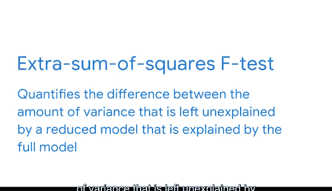

# 谷歌高阶数据分析 5：《回归分析：简化复杂数据关系》regression-analysis（中英双字） - P25：25_03_03_顶级变量选择方法.zh_en - GPT中英字幕课程资源 - BV1Ym4y1L7P7

In previous videos， we defined overfitting as a problem when we modeled the observed or training data too specifically and are unable to generate suitable estimates for the general population。

One way to better evaluate how good a model is while factoring and overfitting is using adjusted r squared。

 which penalizes unnecessary variables in a model， we learn that adjusted r squared is most effective when we can compare multiple models that are using different subsets of independent variables。

In this video， we'll review a couple of variable selection techniques Thankly。

 Python and our computer will take care of a lot of the work very efficiently。

 but it's important as a data analytics professional to have a high level understanding of what's going on in your machine。

Variable selection， also known as feature selection。

 is the process of determining which variables or features to include in a given model。

 As with many of the processes discussed in this program， variable selection is iterative。

As you grow as a data analytics professional， you will develop a stronger intuition for how to go about variable selection In this video。

 we'll cover forward selection and backward elimination。

 which are based on extra sums of squares F tests。 These simple techniques will allow you to continue exploring the world of multiple regression。

 and prepare you for more advanced techniques covered later。😊。

Forward selection and backwards elimination essentially work from opposite directions of the problem。

 We know that a model with zero independent variables is probably not the best choice。

We know that a model with all of the possible independent variables is also probably not the best choice。

Forward selection is a stepwise variable selection process。

 It begins with the null model with zero independent variables and considers all possible variables to add。

 It incorporates the independent variable that contributes the most explanatory power to the model based on the chosen metric and threshold。

 The process continues one variable at a time until no more variables can be added to the model。😊。

Backwards elimination is a stepwise variable selection process that begins with the full model with all possible independent variables and removes the independent variable that adds the least explanatory power to the model based on the chosen metric and threshold。

The process continues one variable at a time until no more variables can be removed from the model。

 both forward selection and backwards elimination require more cutoff points or threshold to determine when to add or remove variables respectively。

One common test is the extra sum of squares F test。

The extra sum of squares F tests quantifies the difference between the amount of variance that is left unexplained by a reduced model that is explained by the full model。

 The reduced model can be any model that is less complex than the full model for the F test。

 like other hypothesis test。 Data professionals usually evaluated based on a P value。

Based on the P value， we can be fairly confident that important variance is being explained by a given model。

We'll revisit F tests later in this course when we talk more about hypothesis testing and estimating categorical variables。

 but great work so far， we've covered forward selection， backward elimination。

 and extra sum of square's F tests。This provides a great start to variable selection and making intentional decisions when constructing a multiple regression model Coming up。

 we'll go over how to perform variable selection using Python and continue exploring ways to control for overfitting。

