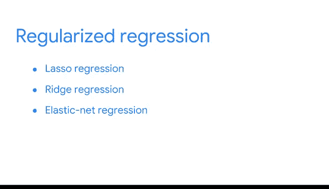

# 谷歌高阶数据分析 5：《回归分析：简化复杂数据关系》regression-analysis（中英双字） - P26：26_03_04_正则化-Lasso、岭回归和弹性网络回归.zh_en - GPT中英字幕课程资源 - BV1Ym4y1L7P7

So far， we've covered a lot about the versatility of linear regression models in impacting business decisions and strategy。

But no tool is perfectPrevious， we introduced the problem of overfitting when a regression model is fit too closely to the training data and therefore has trouble properly estimating the population data。

The problem of overfitting is related to the bias variance trade off。

 a concept at the heart of statistics and machine learning。

The bias variance trade off balances two model qualities， bias and variance。

To minimize overall error for unobserved data， the ideal model has some bias and some variance。

Bas simplifies the model predictions by making assumptions about the variable of relationships。

 A highly biased model may oversimplify the relationship under fitting to the observed data and generating inaccurate estimates。

 For example， given some data， we could assume that y equals2， this is a highly biased model。

Variance in a model allows for model flexibility and complexity。

 so the model can learn from existing data， but a model with high variance can overfit to the observed data and generate inaccurate estimates for unseen data。

 Note， this variance is not to be confused with the variance of a distribution。

 We can think of bias and variance as two ends of a scale。

 we don't want there to be too much bias or too much variance。

 So we have to ask ourselves as data professionals how to balance some bias and some variance to minimize error and get the best model possible。

 speaking about balancing as data analytics professionals。

 We have to balance knowing that even as we gain experience。

 there's always going to be more to learn。 I think it's super important to always keep learning and avoid complacency。

 like you all are currently doing。😊，Personally， I try to attend at least two conferences a year to learn what is going on in the industry and to network with other data professionals。

I'm also really fond of collaborating and asking questions and have found that I learned so much from my colleagues this way。

Know that at this point， you have a really solid foundation and we want to continue working with you to expand your vocabulary and toolkit even further。

Now it's time to learn about regularized regression。

Regularization is a set of regression techniques that shrinks regression coefficient estimates towards 0。

 adding in bias to reduce variances by shrinking the estimates。

 Regularization helps avoid the risk of overfitting the model。

 There are three common regularization techniques。 Lasso regression。

 Rige regression and elastic net regression。

We won't go into all of the mathematical underpinnings of the techniques。

 but there are lots of resources in this course and online for you to explore further if you're interested。

For all three kinds of regularized regression， some bias is introduced to lower variance in the model。

Lasso regression completely removes variables that are not important to predicting the Y variable of interest in Rige regression。

 the impact of less relevant variables is minimized。

 but none of the variables will drop out of the equation。 Ridge is a great option。

 If you want to include all of the variables。When working with large data sets。

 we can't always know if we want variables to drop out of the model or not。

 so we can use something called elastic net regression to test the benefit of Lasso Rige and a hybrid of Lasso Rige regression all at once。

Each regularized regression technique is trying to help us better fit our model。

 but keep in mind that the estimated parameters are much harder to interpret than with simple linear regression or multiple regression。

That concludes our brief exploration into regularization and the bias variance trade off。

 Now that you know the basics of regularization and the bias variance trade off。

 you can continue learning about how to find the best regression model。 Keep up the great work。

 and I'm excited for us to continue on your journey to regression analysis。😊。

