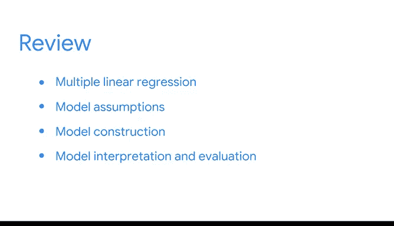

# 谷歌高阶数据分析 5：《回归分析：简化复杂数据关系》regression-analysis（中英双字） - P27：27_03_01_总结_3.zh_en - GPT中英字幕课程资源 - BV1Ym4y1L7P7

Wow， we extended a lot of what we learned about simple linear regression to multiple linear regression。

While simple linear regression models the linear relationship between one independent variable x and one continuous dependent variable Y multiple regression models the linear relationship between two or more independent variables and one dependent variable。

The allowance for multiple independent variables provides data analytics professionals with the ability to ask a wider variety of questions。

We reviewed the model assumptions for simple linear regression and extended them to multiple regression。

The model assumptions that apply to multiple linear regression are linearity。

 independent observations， normality， Hoidasticity， and no multicollineity。

 We showed how to test each of these assumptions using either math built in Python functions or through visualizations during EDA。

We highlighted multiculonity as that assumption is specific to multiple regression。

 We then provided some examples of how to code a multiple regression in Python。

There are similarities with coding a simple linear regression， but there are some key differences。

 Next， we focus our time together on how to interpret and evaluate multiple regression results。

 Now that we have so many independent variables。 we also discuss understanding the computer output。

 which is critical to providing accurate and nuanced storytelling， Lastly。

 as part of model interpretation and evaluation， we review the problem of overfitting and ways to counteract it。

Overfitting occurs when a model too closely matches a training data set or observe data and is unable to predict unseen data or generalized to the population either。

To combat overfitting， we discuss two variable selection techniques。

 forward selection and backward elimination。Both use the extra sum of squares F tests to determine whether to add or remove a variable。

To wrap variable selection， we provided an overview of regularization。

 which helps prevent overfitting to understand regularization， we define the bias variance trade off。

 which is core to many data science and machine learning model decisions。

A model with high bias might underfi the data over simplifyimpling the model。

A model with high variance might overfit the data， over complicating the model。

We introduced three regularization techniques， Lasso， Rige， and elastic net regression。

They all add bias to reduce variances。 Regularization is particularly helpful when working with large data sets。

 as it can be difficult to predetermine which variables are or are not important。

 Wonderful work so far。 We've gone over many concepts。

 Everything we've worked on together is here for you to review on your time。 Good luck。

 And I'll join you again next time。😊。