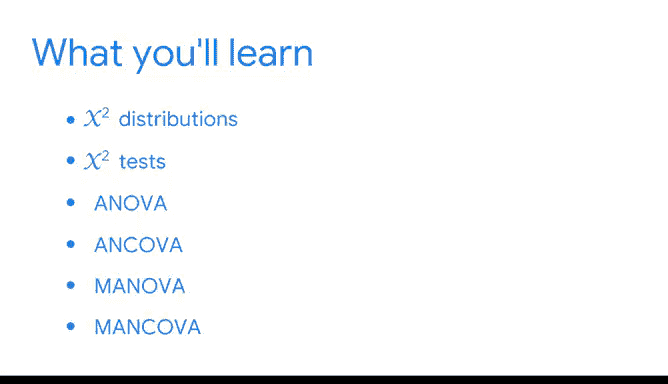

# 谷歌高阶数据分析 5：《回归分析：简化复杂数据关系》regression-analysis（中英双字） - P28：28_04_01_欢迎来到模块4.zh_en - GPT中英字幕课程资源 - BV1Ym4y1L7P7

Hey， welcome back to modeling variable relationships。

 We've covered a lot of material about regression so far。 We worked through the assumptions。

 construction， evaluation and interpretation of simple linear regression model and then build a more complex model using multiple regression。

 these tools gave us powerful ways to ask and explore questions about continuous variables for example。

 if we were interested in understanding product sales。

 multiple regression would allow us to consider the impact of both digital video and print advertising on sales。

😊，Now we'll start focusing more on categorical variables by expanding our toolkit to include more hypothesis testing。

 we can start asking and answering a different range of questions。 For example。

 is the difference among three or more groups statistically significant is the distribution of observed data different from what we expected perhaps we're conducting user research and you want to make a change to the website you're analyzing you can use hypothesis testing to determine if user engagement is different between a couple groups where each group is using distinct website layout recall that hypothesis testing is a statistical procedure that uses sample data to evaluate an assumption about a population parameter。

You are testing hypotheses about a population to see if there are any significant differences。

 For example， in the case of user research on a website。

 you could test the hypothesis that changing the color of the subscribe button or the placement of images might change how much time users spend on the website。

You can utilize different models and tests from your data toolbox to answer various questions。

You can also use some techniques together， for example。

 sometimes you might want to combine a regression model with hypothesis tests or a series of hypothesis tests。

The core principles of data analysis continue to apply to each technique。

 we want to explore and better understand the relationships between different variables we can use what we have learned to tell compelling stories about the data。

Based on the kind of data we have available， we can determine which test or model will be most appropriate。

But sometimes we have to use several tests and models before we can determine the best approach to answer our questions。

 In this video， we'll start with chi squared distribution and chi squared test。

 Chi is the 22 letter of the Greek alphabet and looks a lot like a fancy capital X in English。

 Our discussion will expand on prior learnings about T test and hypothesis testing。

 Chi squared test will help us determine if two categorical variables are associated with one another。

 and whether a categorical variable follows an expected distribution。 For example。

 if we flip a two sided coin many， many times， we would expect about half of the time。

 one particular side comes up。About the other half of the time， the other side comes up。Next。

 we will examine analysis of variants or AOVA and its variance。

 analysis of covariance and COVA and multivariate analysis of variant。

 and covariant ManOva and ManCOVA respectively by unpacking variable relationships with a focus on categorical data we'll be able to expand the types of data we can effectively use to draw conclusions about various decisions。

 strategies and practices in industry。

