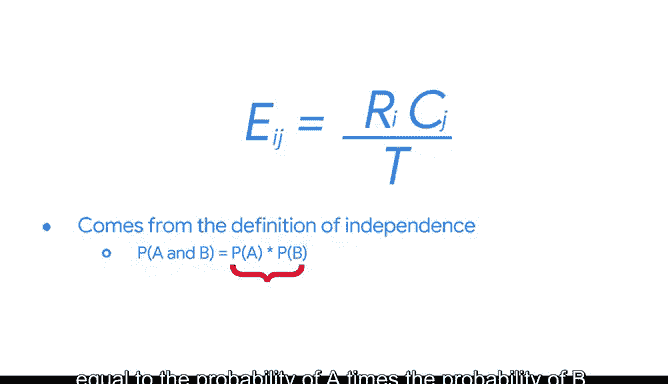

# 谷歌高阶数据分析 5：《回归分析：简化复杂数据关系》regression-analysis（中英双字） - P29：29_04_02_卡方假设检验.zh_en - GPT中英字幕课程资源 - BV1Ym4y1L7P7

Previously， we encountered hypothesis testing in the form of one tail and two tail T tests。

T tests help us answer questions about whether the mean of two different groups is significantly different。

 In this lesson， we'll explore if our data is what we expected it to be。

We'll introduce two hypothesis tests。 the chii squared goodness of fit test and the chii squared test of independence。

These tests will help us compare our expected and observed data。

We'll revisit null and alternative hypotheses when we define chi squared tests just like you might have done with T tests。

 when using linear regression， we were primarily focused on continuous variables。

 But what if our variables aren't continuous Chi squared tests can address questions involving categorical variables。

 For example， let's say your working at a movie theater， which sells small， medium。

 large and extra large portions of popcorn。 you have projections or some expected counts of how each size will sell in a bar chart。

 it can be difficult to determine if the expected counts are statistically the same as what you observed。

 but you can run a chi squared goodness of fit test to answer the question。

 The chi squared goodness of fit test determines whether an observed categorical variable follows an expected distribution。

 As a data practitioner for the movie theater we mention。

 your working on the popcorn cell problem and。😊，claimsim that 25% of people order each size on any given day。

 Now， you can create a table of counts based on the number of popcorn buyers on a given day。

 So let's say 100 people bought popcorn yesterday。 Then you can multiply the percentage by the total to figure out the expected counts for each cell in the table。

25% of 100 is 25。 So you expect that 25 people bought each size of popcorn。

 for the chi squared goodness of fit test， the null hypothesis states that 25 people by each size of popcorn on any given day。

 Basically， the null hypothesis states that the variable follows the expected distribution。

 If we accept the null hypothesis。 then we can say that the observed distribution of popcorn cells is the same as what the employee claims。

 The alternative hypothesis states that the variable doesn't follow the expected distribution。

 Basically， the distribution of the observed data is significantly different from what we expected it to be。

 This means that different。Number of people by each size of popcorn on any given day。 In this case。

 the chi squared statistic equals the sum of the observed number minus the expected number squared。

 divided by the expected number。 Once you gather the observations about popcorn cells。

 you can then use the chi squared statistic to calculate the P value and determine if you can reject the null hypothesis at the given confidence level。

 The next test is called the chi squared test for independence。

 Sometimes called a test of homogeneity。The chi squared test for independence determines whether or not two categorical variables are associated with each other。

 For example， let's say you are wondering if whether is associated with popcorn sales。

 maybe when it rains， people are more likely to buy buttery popcorn to state the hypothesis。

 you first need to determine your variables in the popcorn case。

 the first variable could be whether there's rain or not。

 the second variable could be if more than 100 people buy popcorn。

 or if 100 people or fewer by popcorn， now we're ready to state hypotheses。

 The null hypothesis in the test for independence is that the variables are independent。

 and are not associated with each other。 The alternative hypothesis states that the variables are not independent and are associated with each other。

 for the chi squared tests， It's important to construct a two by two table of counts to see how many observations fall under each category。

 Let's say we have data from the。Sum and fall popcorn sales。 There were 275 days of data collected。

 including 83 days where it rained and 192 days where it did not on 135 days more than 100 people bought popcorn and on 140 days。

 fewer than 100 people bought popcorn。 you can then fill in each cell with the count of days for each category。

 You can then calculate the expected value for each cell in the two by2 table using the following formula。

 The expected value for the cell in the Ithe row and J column is equal to the total of row I times the total of column J divided by the total count in the two by two table。

 The formula comes from the definition of independence， where two events are independent。

 If the probability of both occurring。 Pro of a and B is equal to the probability of a times the probability of B。

The observed value is just the count for the cell in the Ih， row and Jith column。

You can then use the same formula as the goodness of fit test to calculate the chi squared statistic。

As with the goodness of fit test， you can use the chi squared statistic to calculate the P value and determine if the two categorical variables are independent or not。

Great work Will cover a couple of the assumptions of Chi square tests and how to perform Chi square tests in more depth in upcoming readings。

 The key here is connecting concepts you have learned about hypothesis testing to these chi square tests。

 as well。😊，You'll answer more questions about categorical variables soon。

