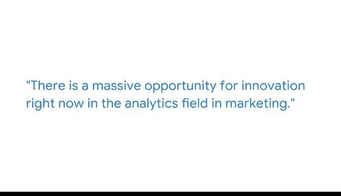

# 谷歌高阶数据分析 5：《回归分析：简化复杂数据关系》regression-analysis（中英双字） - P2：02_01_03_Tiffany-通过回归模型获得可操作的见解.zh_en - GPT中英字幕课程资源 - BV1Ym4y1L7P7

Hi， I'm Tiffany。 I'm a marketing science lead here at Google。

 I have always loved math and stats So from a very。

 very young age I was kind of drawn to that probably because that was one of the only things that I was good at in school。

 I just remember my brother struggling with his math homework and he was two years older than me so probably when I was like in first grade I would sit down with him and help him with it in my role as a marketing science lead I build a lot of regression models to predict things like who is going to be a high valued customer or how to best allocate my budget across different campaigns regression models are super important powerful tools you'll be able to answer a wide variety of questions using different types of regression models more recently I've been building models and trying to interpret the co So I've been building a lot of regression models to identify things like who's a high value customer。

Or who's going make multiple purchases in a year by analyzing website behavior。

 So we really want to get down to which pages or which actions that people are taking on a website that's indicative of them being a high value customer or someone who makes multiple purchases within a year。

 I love being able to take large amounts of data and being able to solve massive problems。

 I recently worked with the client who wanted to know how to optimize their millions of dollars of marketing budget across different channels。

 and by building a regression model， we were able to help them optimize their spend in order to increase sales。

 Some of the opportunities that we currently face is thirdpart cookies are going away。

 I'm sure you've all had sort of an ad that follows you around on the Internet before。

 So that was enabled by thirdpart cookies。 And so with those going away。 we have a whole。😊。

Brand new opportunity to come up with different model types and different analyses to try to do things that we were easily able to identify previously using third partyy cookies in that tracking system and so there is a massive opportunity for innovation right now in the analytics field in marketing Things are constantly changing and there's so much information out there that you're never going to know everything that you need to know so just keep an open mindset and an always learning mindset is going to be key know that there's so many resources out there for you to research learn and you can do that as you go。

