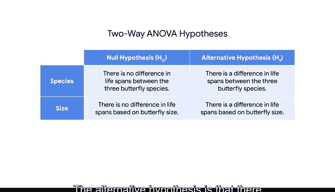

# 谷歌高阶数据分析 5：《回归分析：简化复杂数据关系》regression-analysis（中英双字） - P30：30_04_01_方差分析介绍.zh_en - GPT中英字幕课程资源 - BV1Ym4y1L7P7

Knowing our data well helps us determine what we can do with the data。

 it helps us understand which tests we can run， which tests we can't run。

 and which tests we might be able to run if we transform the data a bit more。In prior videos。

 we showed the difference between continuous and categorical variables。

 We've spent most of this course so far talking about linear regression。

 which can estimate continuous variables of interest。

 But there is so much categorical data out there。 So far。

 we've learned about the chi squared goodness of fit test and test of independence。😊。

Both of these tests examine the relationship between categorical variables。Now。

 we'll focus on analysis of variance or anovava， which helps examine the relationship between categorical variables and continuous variables。

 Analysis of variance commonly called Anova is a group of statistical techniques that test the difference of means between three or more groups。

 If this sounds familiar。 you might recall T tests， which are a common statistical tests。

AOva is an extension of T tests。While tea tests examine the difference of means between two groups。

 Anova can test means between several groups。 Let's say you work at a botanical garden。

 And you're wondering if different species of butterflies have different lifespans。

A NOVA testing can help in this situation。There are two main types of anovava test。

 one way and two way。 One way。 Anovava testing compares the means of one continuous dependent variable in three or more groups will use a categorical variable to represent the groupings。

 When using anovava， we have a null hypothesis and an alternative hypothesis。

 Let's say you're measuring the lifespans of three different butterfly species， Monarch。

 Mor cloak and swallowlettail butterflies。Your colleagues suggest that the lifespans may be the same。

 regardless of butterfly species。 Since the null hypothesis is that the lifespans are equal。

 a one way anovava test is appropriate。 This means that the lifespan of monarch butterflies is equal to the lifespan of morning cloak butterflies。

 which is also equal to the lifespan of swallowtel butterflies。

 We can write H not as mu monarch equals mu morning cloak equals mu swallowel。

 to generalize we can use one way a nova when the null hypothesis states that the means of each group are equal。

 The alternative hypothesis would then be the lifespan of these three butterfly species are not all the same。

 This is a little difficult to express using math symbols。

 So you can just write not before the null hypothesis。

 So not mu monarchs equals mu morning cloak equals mu swallowel。

 Only one of the mean lifespan has to be different to reject the。

We represent the alternative hypothesis as H sub1 or H1。

 because you may run more complex tests in the future where you are testing more than two hypotheses at once。

One way a Nova is a great tool， but sometimes you might encounter situations in which there are two factors that are associated with the continuous dependent variable at the Botanical garden。

 Let's say you want to study if butterfly lifespan is related to the species of the butterfly and the size of the butterfly。

Imagine the butterflies can be small， medium or large。Now。

 the data is varying according to two factors。 Spec and size  Two way a Nova testing compares the means of one continuous dependent variable based on two categorical variables。

 You are now testing three null hypothesis and alternative hypothesis statements at once。

 The first null and alternative hypothesis pair is the same as before。

 They focus on the relationship between species and lifespan。

 The null hypothesis states that there is no difference in lifespans between the three butterfly species。

 The alternative hypothesis states that there is a difference in lifespans between the three butterfly species。

 The next pair of hypothesistheses focuses on our second new categorical variable。 size。

 The null hypothesis is that there is no difference in lifespans based on butterfly size。

 The alternative hypothesis is that there is a difference in lifespans based on butterfly size。

 The last pair of hypothesisses test the interaction between the two variables。 This concept。

Interaction may be familiar from our work on multiple regression。

 The null hypothesis states that the effect of species on lifespan is independent of the effect of butterfly size and vice versa。

 the alternative hypothesis states that there is interaction effect between butterfly size and species on lifespan。

Regression lets you understand how independent variables impact dependent variables。

Anova allows you to zoom in on some of those relationships to tell a complete story by unpacking relationships in a pairwise fashion。

Wonderful job。 In this video， we review the differences between one way and two way in Nova。

 and we're able to state the null and alternative hypotheses for each test in our butterfly scenario。

 Next， we'll learn how our computers and Python can help us run a Nova test。😊。

