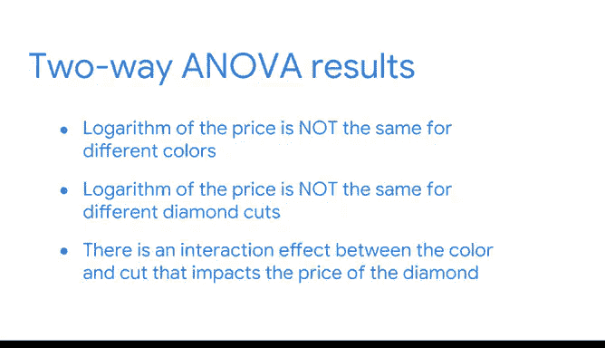

# 谷歌高阶数据分析 5：《回归分析：简化复杂数据关系》regression-analysis（中英双字） - P31：31_04_03_使用Python探索单因素与双因素方差分析检验.zh_en - GPT中英字幕课程资源 - BV1Ym4y1L7P7

At the core of all of our regression analyses and statistics is storytelling。

 We want to understand how the different variables are related。

 although regression and anova can help answer similar questions。

 one or the other might be more useful in specific cases。

 a regression analysis will help provide a holistic picture of if and by how much a number of different variables impact an outcome variable。

On the other hand， aOA helps unpack pairwise comparisons among subsets of those variables to better understand the nuances among the elements that fuel the regression analysis。

A no can work like a magnifying glass， zooming in on specific parts of the regression story。Now。

 let's use a subset of a dataset set about diamonds to explore Anovava in Python。

 You can load in the original dataset set through the Seaborn library。

 We've already cleaned the data and transformed some variables。 We have two variables。

 logarithm of the price and the color grade of each diamond。Using panndas， load in the CSV file。

Now that the data set is loaded in， examine the data， if you haven't already。

 import the seaborn package as SNS。Use a box plot to determine how the price varies based on the color grade。

There are a few different color grades represented。D， E， F H， and I。

There seems to be some variation in the log of the price。

 but it's not clear if there is a difference based on color grade。

So let's test it out using a one way Anovava。Youll be using the Stats Models module。

Start by creating a regression model using the OLS function and then fitting the model to the data。

 using the fit method。This will allow you to use the Anova function to see if there is a statistically significant difference in price between the groups。

 remember that you have to add the capital C and parentheses around color in the OLS formula to indicate color is a categorical variable。

Based on the results from the model， you can observe that there is a statistically significant relationship between diamond color and price。

 but it's unclear if the price differs between the various colors to learn more。

 you can run a one way A NoA test。You can create an AOva table using the stats models。

 a Nova underscore LM function。 The table will provide you with statistics about the color variable。

Recall that a one way A NOVA test compares three or more groups of one categorical independent variable based on one continuous dependent variable。

Let's state the null and alternative hypotheses。The null hypothesis is that there is no difference in price of diamond based on color grade。

The alternative hypothesis is that there is a difference in price of diamond based on color grade。

Note there are different Anova types，1，2， and3， which you can read about in the documentation。

 The Anova table gives you the sum of squares and degrees of freedom for the color variables and its residuals。

 as well as the F statistic and P value for the color variable。From the results。

 the P value is very small， which means that you can reject the null hypothesis that the mean of the price is the same for all diamond color grades。

Now， let's add another categorical variable into the mix。 Let's add in the cut of the diamond。

 There are three kinds of cuts to include ideal， premium， and very good。

You can load in the data that has been cleaned。You'll do the same as before and first fit a regression model。

 but the equation will address the possible interaction effects between cut and color。

The colon indicates interaction between the color and cut categorical variables。

Before you run the2 A AnovaA test， let's review the three hypothesis pairs you'll be testing First up are the null and alternative hypotheses about diamond price based on color。

Next are the hypotheses about diamond price based on cut。

 Lastly are the hypotheses about the interaction between color and cut on diamond price。

Now get the results of a twoA ANOVA test using the same ANOVA underscore LM function。

The table includes a row for each of the two categorical variables and a row for the interaction between cut and color。

Since the P value is very small for all three， you can reject all three null hypotheses。

In conclusion， the logarithm of the price is not the same for different colors。 Additionally。

 the logarithm of the price is not the same for different diamond cuts。 Finally。

 there is an interaction effect between the color and cut that impacts the price of the diamond。

Wonderful job。 In this video， we reviewed the difference between one way and 2 A A Nova。

 the null and alternative hypotheses， as well as how to code and interpret the results from Python。

 We've covered a lot so far。 and in the following videos and readings。

 we'll continue exploring the power of A NOA testing。😊。

