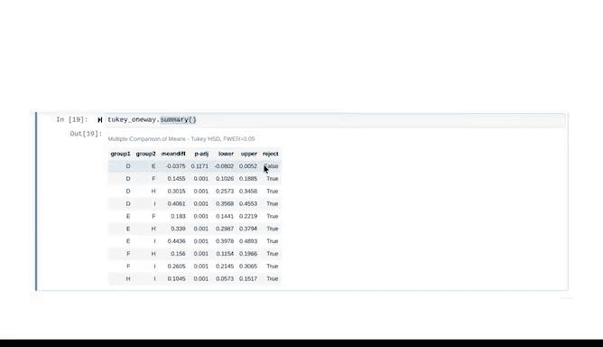

# 谷歌高阶数据分析 5：《回归分析：简化复杂数据关系》regression-analysis（中英双字） - P32：32_04_04_使用Python进行方差分析事后检验.zh_en - GPT中英字幕课程资源 - BV1Ym4y1L7P7

Previously， we talked about the effectiveness of a Nova testing to understand continuous variables a bit more in relation to categorical variable of interest。

To recap aOVA testing can be applied to the results we get from a linear regression。

If we have a categorical independent variable such as diamond color。

 and we're trying to estimate the price of a diamond。

 we can use an a Nova test to determine if there is a statistically significant difference in price based on diamond color。

 But as we stated before， the null hypothesis just states that the means are different。

 If we have three or more groups， we don't know which one is different or how many are different from each other。

 There might be cases where it's really important to know if one category in particular is different。

 For example， if youre building a roller coaster， you will be choosing among a couple of different material types based on their strengths。

 You really want to know if and how much the material differ in strength。 In this case。

 an a Nova post hoc test can be helpful。 And a Nova post ho test performs a pairwise comparison between all available groups while controlling for the error rate。

 If you recall， from learning about statistics， we have confidence intervals and P values to quantify our insert。

There is always a small chance that we falsely reject the null hypothesis purely based on probability。

 Fsely rejecting the null hypothesis is sometimes referred to as type 1 error。 Typically。

 there's a 5 per chance we've rejected the null hypothesis when it was actually true。

But if we run a bunch of tests， all with a 5 per cent chance that we're incorrectly rejecting the null hypothesis。

 the chance that we've made a mistake multiplies。 So the odds that we've made at least one mistake increases very rapidly。

 The more tests we perform。 Post ho andnovava test control for that increasing probability。

 One of the most common A Nova post ho test is the Tkis HSD。Honestly significantly different。

 After performing a Nova test where you get statistically significantly results。

 All you know is that at least one of the groups means are different。😊。

Tki's HSD tests will then compare all the pairs of groups and determine which pairs are different from one another while controlling for the fact that you're running multiple hypothesis tests all at once。

 Now， let's return to the one way Anovava Dia example。

 Let's say you already have your packages imported from last time。

 And you've saved the data set as a data frame called diamonds。Create the linear model again。

You already know that there is a statistically significant relationship between color and price。Now。

 run the one way Anova just like before here， you can observe that the P values are much smaller than 0。

05。 So the results are statistically significant。 and therefore。

 you can reject the null hypothesis that the mean price is the same across all diamond colors。

 Now that you have significant results from Nnanova test。 you can run the twoki's HSD post hoc test。

 First， import the Python function。 pairwise underscore twokis HSD from S M。 Next， run the test。

 the N O variable indicates which variable is being compared across groups。

 The groups's variable tells the function which variable holds the groups you're interested in。

 In this case， color。 The alpha variable tells the function the significance or confidence level you are testing for。

 You set alpha to 0。05。 as you are aiming for a 95% confidence level。

 You can access the results of twoies test in two ways。 One way。😊，Is to use the summary function。

 You can also use the print function。 In both cases。

 you can observe all of the pairwise comparisons between each pair of diamond color grades。

There is an adjusted P value column， a column with the lower and upper bound of the confidence intervals。

 as well as a column letting you know whether or not you can reject the null hypothesis。

If the reject column reads false， then you cannot reject the null hypothesis。

 If the reject column reads true， then you can reject the null hypothesis。

 The null hypothesis is that the diamond prices between the two color grades are the same。

 but the two's HSD test informs us that you can reject the null hypothesis with the P value of 0。001。

 For example， the diamond price is not the same for H and I grade diamonds。

Awesome job today to recap combining tests may seem like a complex task。

 but it's so powerful to have a wide set of tools to run analysis。

 We'll continue unpacking a nova and post ho test in the course materials。 As always。

 revisit any prior videos and readings as needed。 You can do this。 Good luck。

 and I look forward to joining you again next time。😊。

