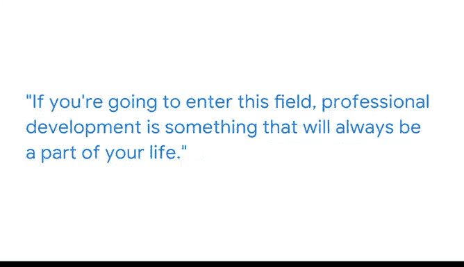

# 谷歌高阶数据分析 5：《回归分析：简化复杂数据关系》regression-analysis（中英双字） - P33：33_04_05_Ignacio-职业发展各阶段的发现.zh_en - GPT中英字幕课程资源 - BV1Ym4y1L7P7

My name is Ignao I'm a staff economist in the chief Econist team。

 I was born in Argentina and being born into a middleclass family in Argentina means that I get to experience every single economic crisis that you can imagine in my most formative years and that probably got me interest in economics which some people say the original data science I started working in public policy。

 trying to help decisions makers in health and education use data to inform some hard decisions they have to make。

😊，And after five years of doing public policy， I moved into the tech sector and I started working at Google where I use the same toolkitba to inform a business decisions。

 If you are going to enter this field， professionalfessional development is something that will always be a part of your life。

When I finished my PhD I say， okay， I have my toolkit。

 I can go and answer any questions like that's not the case soon after when I started my first job in policy research I remember these very senior statistician came to me and say like what you are doing is great but if you were using these different tools it would be way better I quickly learned that there were things that I could learn that I didn't learn in grad school that I would help me be better on my job。

😊，And I made the decision of investing on myself and that basically meant that on a weekend I would wake up early and I would watch some YouTube lectures that people recommended me or I would read a book that people recommended to me and once I learned what I wanted to learn I remember talking with my boss at the time and say。

 we just did this thing for this client， but now I want to do it in a different way。😊。

And I also want to show them and see what they think。By the time I left my previous job。

100% of my work was using that new toolkit that I learned while at the job。And I expect that。

5ive years from now， the tools that I'm going to be using are probably going to be almost exclusively things that I haven't learned yet。

 So， so you're probably finishing your advanced data analytics certification and you are asking yourself what is next。

 So my guess is that you're a self-motivated person and you can learn by yourself And today doing that is quite easy because resources are free available online you can go to a virtual conference from your home。

 you can watch a lecture on YouTube。 You can be on econ Twitter and learn what is the latest innovation in methodologyology that may help you answer a business question you're working on that day。

 And once you're starting that world you can go down the rabbit hole and like learn more and more。😊。

