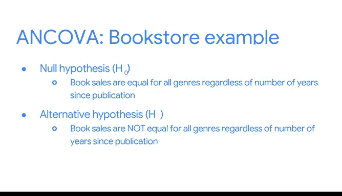

# 谷歌高阶数据分析 5：《回归分析：简化复杂数据关系》regression-analysis（中英双字） - P34：34_04_01_协方差分析.zh_en - GPT中英字幕课程资源 - BV1Ym4y1L7P7

So far， we've learned some exciting ways to uncover stories about categorical variables。

One of these tests is aOA or analysis of variance。Anova helps us learn more about the differences in continuous y variable based on different groupings。

 using AOva， we can determine whether groups are actually different from one another。

 You may recall that when we learned about simple linear regression。

 we could only take into account one independent variable to explain the variance of one dependent variable。

Then we learned about multiple regression， which allowed us to incorporate lots of different factors into our analysis。

By working with simple linear regression， you build a strong foundation for understanding the mechanics of regression modeling。

By working with multiple regression， you were able to vastly expand the kinds of questions you could explore。

 for example， using simple linear regression， you could explore the relationship between the weather and ice coffee sales。

But with multiple regression， you could then include temperature and distance to public transportation or other variables you think might be related to coffee sales。

 There's a similar relationship between annova and an cova or analysis of covariants。

 analysis of covariance or and Cova is a statistical technique that test the difference of means between three or more groups while controlling for the effects of covariates。

 Covariates are the variables that are not of direct interest to the question we are trying to address。

 by taking the covariates into account。 we can better isolate the relationship between the categorical variable we are interested in and the y variable This allows us to draw more accurate conclusions about the relationships among the variables。

 For example， if examining ice coffee sales and Cova allows you to analyze how the sales are different on workday versus the weekend。

 while controlling for the temperature of the day。 Let's say we have a drop in sale。One weekend。

 we could assume that no one buys coffee on weekends because they're not going to work。

 but perhaps it was especially cold that weekend An Cova allows us to double check whether temperature was a factor。

 You might wonder why a data analytics professional would use AnCOva when we already have linear regression analysis we can use。

 There are many similarities between An COVA and linear regression。 For example。

 both allow for continuous and categorical independent variables。

 both focus on a continuous y variable and both center on understanding relationships between variables。

But the use cases depend on which variable we're most interested in understanding with an Cova。

 while we are not focused on the covariates， we are including covariates to gain a clear understanding of the categorical variable。

 with regression， we might be interested in all of the independent variables or in predicting the y variable for unseen data。

That was a lot。 We've gone through one way Anova，2 way Anova and Ancova after covering various linear regression models。

 all of these are important concepts to be able to talk about as a data analytics professional。

 But don't feel like you have to remember everything we're going through verbatim。😊。

That would be really hard when you're working on a new project。

 you'll be able to refresh your memory by revisiting this course。

 doing a quick Google search or asking other people。 I literally do this every day。 For instance。

 I don't remember every equation off the top of my head。

 But what's important is knowing that there are assumptions and equations。 And when I need them。

 I can either look at my past code or search for them。 If you're anything like me。

 you'll get really good at fine tuning your searches。😊，Going back to Ncova。

 we're dealing with hypothesis tests。 So it's important to state our null and alternative hypothesis before running a test。

 We'll cover how to run the test in Python later in this course。In this video。

 we'll focus on understanding what kinds of questions and COVI can help us answer。

 Let's say that you're working at a bookstore and you're interested in the relationship between book genres and sales。

It seems new books tend to get more attention because authors are traveling to promote their recent work。

The good news is that An CoVva will let us control for publication year。

Controlling for other variables is important， so we don't draw conclusions that are not accurate。

 In this example， the categorical independent variable is book genre。

The covariates is the year since the book was published。

The continuous dependent variable is the number of books sold in the last month。

The null hypothesis or H not is that books cells are equal for all genres。

 regardless of the number of years since publication。

 the alternative hypothesis or H1 is that books sales are not equal for all genres。

 regardless of number of years since publication， just like with Anova。

 you have Python and our computers available to run the test and the math。

 but you need to interpret the results。 Typically， if the test yields a P value of less than 0。05。

 you can reject the null hypothesis that all of the means were the same。

 Even when controlling for the covariates。 Great work。

 we've reviewed a lot about the importance of NCOva。

 which you can add to your data analysis toolkit Now。 As always。

 remember that there are additional resources for you to keep exploring Anova and its variances。

Good luck， and until next time， keep exploring interesting questions and telling compelling stories。

