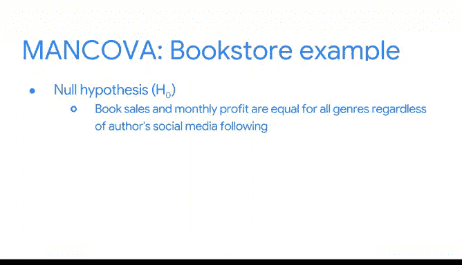

# 谷歌高阶数据分析 5：《回归分析：简化复杂数据关系》regression-analysis（中英双字） - P35：35_04_02_更多因变量-MANOVA和MANCOVA.zh_en - GPT中英字幕课程资源 - BV1Ym4y1L7P7

Remember how far you've come on your data journey so far。

 you've built and extended a number of models and tests from their most basic form to include more variables and different kinds of data。

As you've explored various models， you've encountered different questions you can answer and different use cases for each model。

You've made the shift from a Nova to andCOva， much like you extended simple linear regression to multiple regression。

 You added more independent variables to help isolate the effect of each X variable on the Y variable in question In this video we'll add more dependent variables to allow us to perform new and different kinds of comparative analyses。

 The two test will introduce our mannovava and mancova based on the names you might be able to guess how these relate to aOva and NCOva Mannova or multivariate analysis of variance is an extension of aOva that compares how two or more continuous outcome variables vary according to categorical independent variables like AO the two most common versions of mannova involve one or two categorical independent variables and are referred to as a one way and two way mannova。

The independent variable must be categorical， and the outcome variables must be continuous。

 Since we're still dealing with hypothesis testing。 We need some hypotheses to test。

 Let's return to the bookstore example to generate and test new hypotheses about factors relating to book sales。

 The one categorical variable will be book genre。 The two continuous dependent variables could be the number of books sold per month and profits from the book sales。

 Let's say yourre working with a one way manova test。 In this case。

 the null hypothesis would be that the means of both continuous variables are equal for every book genre。

 So the number of books sold per month is the same for each book genre。

 and the profit from selling books is the same for each book genre。😊。

The alternative hypothesis would be that the means of both continuous variables are not equal for every book genre。

 This indicates that the only two genres of books must differ for just one of the outcome variables were examining。

 For example， perhaps the profit made from self help books differs from the profit made from science fiction books。

 or maybe the number of graphic novels sold per month differs from the number of historical fiction books sold per month。

In either case， you could reject the null hypothesis。

 Mannovava allows us to think of each data point as having a number of characteristics。

 which are the continuous y variables that we want to understand based on one or two sets of groups we care about。

 the one or two categorical x variables。If， however。

 we're only interested in one categorical variable and we want to control for another variable。

 we can use manCOVA， manCOA or multivariate analysis of covariance is an extension of AnN COA and ManOA that compares how two or more continuous outcome variables vary according to categorical independent variables while controlling for covariates。

Let's say you're still interested in whether book genre is related to the number of books sold and the amount of profit。

 but you want to control for the popularity of the author。 Then you could use man Cova。

 the categorical X variable is still book genre。 But now you add a covariate。

 which is the follower account and author has across social media platforms。

 which you are controlling for。 Then the two Y outcome variables remain the same。

 The number of books sold per month and the monthly profit。

 The null hypothesis is that books saless and monthly profits are equal for all genres。

 regardless of the author's social media following。

 The alternative hypothesis or H1 is that books sales and monthly profits are not equal for all genres。

 regardless of the author's social media following。 As you continue expanding your data toolkit。

 you'll encounter more test tools and models that build off each other。

Identifying the connections in use cases is important as you continue throughout your career as a data professional。

 I'm excited for you to continue testing your hypotheses。

