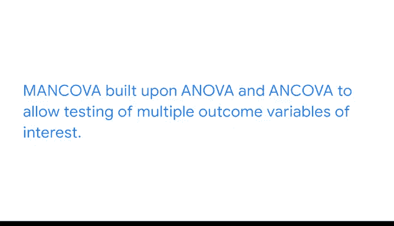

# 谷歌高阶数据分析 5：《回归分析：简化复杂数据关系》regression-analysis（中英双字） - P36：36_04_01_总结_4.zh_en - GPT中英字幕课程资源 - BV1Ym4y1L7P7

Everything we've covered so far has allowed us to explore categorical variables in different ways by fully utilizing the assortment of tools available with regards to categorical variables。

 We'll be able to tell a wider variety of stories in your data。 After all， we are scientists。

 and sometimes we need to try out a few tests in order to figure out the story that the data holds。

 starting with just understanding one categorical variable。

 We examine the chi squared goodness of fit test， which determines whether a variable matches of theoretical distribution。

 Then the tests of independence helped us determine whether two categorical variables were independent of one another。

  moving beyond the chi square distribution。 We discovered a Nova or analysis of variance。

 Anova forms the basis of all the other tests we covered in this section。 One way。

 Anova is a powerful way to determine if there are differences in a continuous outcome variable between groups you're interested in。

😊，TwoA AOVA allows you to gain similar insights while incorporating another set of groups as well。

 and COva built upon the idea of AOVva by allowing us to control for another variable to isolate the effect of the groups from Covariates。

ManCOva built upon AOva and AnCOva to allow testing of multiple outcome variables of interest。

 As with any hypothesis testing， all of these tests had null and alternative hypotheses。

Stating these hypotheses helps you to articulate what you're trying to learn from running these tests。

 I encourage you to continue working through scenarios with hypothesis tests。

The more questions you ask， the more the data will reveal。

 Keep in mind the data requirements of each test and that there is always room for error with practice and time。

 you'll be telling impressive stories soon。I'll join you again， next time。

