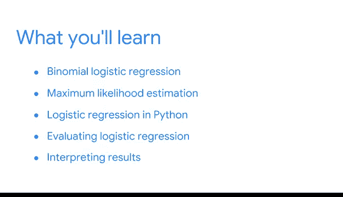

# 谷歌高阶数据分析 5：《回归分析：简化复杂数据关系》regression-analysis（中英双字） - P37：37_05_01_欢迎来到模块5.zh_en - GPT中英字幕课程资源 - BV1Ym4y1L7P7

Hello， it's great to be with you again。 When we learned about linear regression。

 we started thinking about different kinds of questions that regression analysis could help us answer。

 For example， we could consider the factors that contribute to penguin's body mass or factors that affect clickthroughs on a website。

 We're going to expand the kinds of questions we can ask This time will focus on modeling the probability that an event will occur。

 There are lots of problems that we could explore。 For example。

 what factors influence the odds that a customer buys from a company again。

 What impacts the likelihood a worker receives high performance ratings。

 What contributes to a user commenting or not commenting on a video。

 Lo regression can help us in these situations。😊。

Remember that logistic regression is a technique that models a categorical dependent variable Y。

 based on one or more independent variables X， the dependent variable can have two or more possible discrete values。

We'll focus mostly on binomial logistic regression。

 which models the probability of an observation falling into one of two categories based on one or more independent variables。

 We use a binary variable Y to indicate the category， For example。

 let's say that you're a data professional working for a basketball team。

 and you want to understand the probability that any given player on your team will score more than 10 points in a game。

 There are many variables you might want to consider。 For example。

 how well did the player perform last season。 What's their average playing time。

 How many points did they score this season。This might seem like a multiple linear regression problem。

 but consider the outcome variable， whether or not the player will score more than 10 points in a basketball game。

 This is a binary outcome variable。 Since there are only two possible outcomes。

 we can't draw a best fit line in the same way we did for linear regression。For example。

 if you plot playing times against whether or not the player will score more than 10 points in a game。

 your data will look like two flat lines，1 at y equals 0， and one at y equals1。

 This is very different from the linear relationship you observed in prior scenarios。

 Later in the program。 We'll learn more about binomial logistic regression and review the stages of regression and pace。

 We'll analyze our data by understanding the model assumptions to the best of our ability。

 and ensure we have a binary outcome variable。 We'll construct our model and evaluate it using several different metrics。

 Then we'll execute and share the results with stakeholders and other team members。😊。

Logistic regression is a versatile and powerful model， and I'm excited to review it with you。

 So let's get started。😊。

