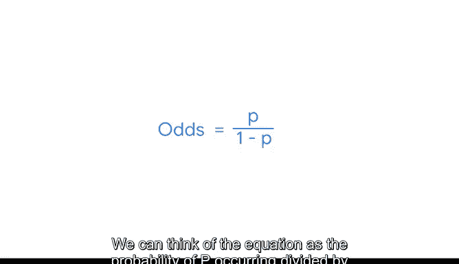
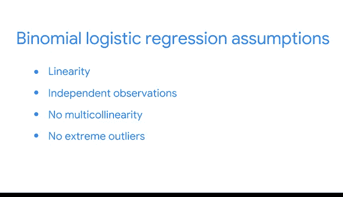

# 谷歌高阶数据分析 5：《回归分析：简化复杂数据关系》regression-analysis（中英双字） - P38：38_05_02_为数据寻找最佳逻辑回归模型.zh_en - GPT中英字幕课程资源 - BV1Ym4y1L7P7

So far， we've learned that binomial logistic regression is a method for modeling the probability of a binary outcome。

 such as how likely it is that a player will score more than 10 points in a basketball game。

Will a user comment or not， but just like any other statistical method。

 we have to make assumptions about the data to have confidence in the results。

Now we'll discuss the main assumptions of binomial logistic regression and consider how to find the best logistic regression model given a set of data。

Logistic regression is a bit more complex than linear regression。

 so our goal is to understand the basics of how it works。

 not to understand every detail of the model。Recall that as we navigate the first two stages of pace。

 we can figure out if a logistic regression model is the best choice to address the question we're working on。

We consider the assumptions of the model as we analyze our approach。

Some assumptions are similar to those of linear regression and some are different。

The first and most important assumption of binomial logistic regression is the linearity assumption。

 which is a bit different from the linearity assumption for linear regression。

In binomial logistic regression， the linearity assumption states that there should be a linear relationship between each x variable and the logit of the probability that y equals1。

The linearity assumption is the key assumption that explains how we can estimate a logistic regression model that fits the data best to understand Loit。

 we must first define the odds。The odds of a given probability P is equal to P divided by 1 minus P。

 We can think of the equation as the probability of P occurring。

 divided by the probability of P not occurring。 For example。

 let's imagine that in a package of cookies with different flavors。

 you know that about 60% are chocolate。 You'll represent this as 0。6。

 Then the probability of a cookie not being chocolate is 0。4， because 1-0。6 is 0。4。

 The odds a given cookie is chocolate is 0。6 divided by 0。4。 which is 1。5。

The logit or log odds function is the logarithm of the odds of a given probability。

 so the logit of probability P is equal to the logarithm of p divided by 1 minus p。

Logit is the most common link function used to linearly relate the x variables to the probability of Y。

To translate this into less technical language， let's explore the basketball example further。

 If you're working for a basketball team as a data practitioner。

 you'll want to know the likelihood of your players scoring many points in a game rather than the other outcome that they don't score many points by assuming that there is a linear relationship between the X variables and the logit of the probability that y equals our outcome of interest or one。

 you can then find some beta coefficient that explains the data you've observed。

You can write the logit of p in terms of the x variables。

 so logit of p equals beta 0 plus beta 1 times x1 plus beta 2 times x2 all the way up to beta n times xn。

 wherein is the number of independent variables you are considering in your model。

And like linear regression， we don't want just any set of beta coefficients。

 We want the best set of beta coefficients to make sure our model fits the data。

 In linear regression， we minimize the sum of squared residuals。

 which is a measure of error to figure out the best model in logistic regression。

 we'll often use maximum likelihood estimation to find the best logistic regression model。

Maximum likelihood estimation or MLE is a technique for estimating the beta parameters that maximize the likelihood of the model producing the observed data we can think of likelihood as the probability of observing the actual data given some set of beta parameters。

To understand these definitions， we need to revisit the assumptions of binomial logistic regression。

Aside from linearity between each x variable and the logit of y variable。

 we assume that the observations are independent。This assumption relates to how the data was collected。

Because the observations are assumed to be independent。

 we can say that the probability of observing data point A and observing data point B is equal to the probability of observing A times the probability of observing B。

Therefore， if you have N basketball players on your team。

 you can calculate the likelihood of observing the outcome for each player and then multiply all of the likelihoods together to determine the likelihood of observing all of the sample data。

The best logistic regression model estimates the set of beta coefficients that maximizes the likelihood of observing all of the sample data。

Now that we have estimated how maximum likelihood estimation works。

 we'll consider two other assumptions of binomial logistic regression。

We assume that there is little to no multicollinearity between the independent variables。

 if we include multiple x variables， they should not be highly correlated with one another。

 just like with linear regression。Lastly， we assume that there are no extreme outliers in the data。

Outliers are a complex topic in regression modeling and can be detected after the model is fit。

Sometimes it is appropriate to transform or adjust variables to maintain model validity。

 other times it can be appropriate to remove outlier data。To recap。

 we've defined the main assumptions of logistic regression and how to fit the best logistic regression model to the data using MLE Com up we'll explore how to build and evaluate a logistic regression model in Python using real data。

 meet you there。

