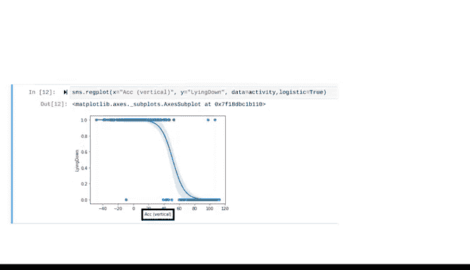

# 谷歌高阶数据分析 5：《回归分析：简化复杂数据关系》regression-analysis（中英双字） - P39：39_05_01_使用Python构建逻辑回归模型.zh_en - GPT中英字幕课程资源 - BV1Ym4y1L7P7

We've explored the kinds of questions logistic regression can help answer。

 reviewed the theory supporting logistic regression and why it's a reliable and foundational data analysis tool。

 In this video， we'll build a logistic regression model in Python。

 which puts us in the construct phase of pace。 to illustrate how to code a binomial logistic regression in Python。

 We'll go through an example with data together。 The data set we'll use comes from a study about motion detection in older adults。

 We've selected a subset of the data to work with。 We've already loaded our data set in a data frame called activity。

 You can call the describe function to get more statistical information about the variables。

 There are 494 rows of data based on the count row。 You can also observe the mean standard deviation。

 minimum value， maximum value and the value at each quartile for every variable。

 Now examine the first few rows using the head function。 There are two variables in the。😊。

Da set the first variable measures acceleration in the vertical direction。

 The second variable indicates whether a person is lying down。

 You want to use logistic regression to predict whether the person is lying down or not。

 load in Psyit learns train test split and logistic regression functions。 Now。

 prepare the data for the Python functions to split the data into training set and a holdout data set。

 Dide the activity data frame into the X variables and y variables as you've done for other models here you'll just focus on one x variable vertical acceleration。

 to follow good data practices， split the data into a training and holdout data set using Psyit learns train test split method。

 you imported earlier。 you'll use the holdout or testing data later when you evaluate the model you're building now。

 We set the random state so that the results are repeatable。

 but you don't always have to set the random state。 If you use a different random state。

 your results will differ。 Next， build the logistic regression model。

And save it as a variable called CF。 This is a name you'll encounter frequently。

 CF stands for the classifier。 Call on the logistic regression function to build a classifier。

 Then use the fit method of the logistic regression classifier and input the training dataset。

 then call on the classifier's coefficient and intercept attributes to get the parameter estimates。

 The coefficient or parameter estimate for beta 1 is negative 0。

118 rounded to the nearest thousandth， and the estimate of the intercept or beta 0 is 6。

102 rounded to the nearest thousandth。 If you want to create a plot of your model to visualize results。

 you can use the cborn package。 So import Cborn using S and S alias if you haven't already。

 then call on the Regg plot function。 You have to tell the function which column the x variableism。

 which is labeled A C parentheses vertical close parentheses。😊，Then specify why variable column Next。

 tell the function where the data is stored。 Specify that youre interested in logistic regression by setting the logistic argument is true。

 The plot displays a sharp S shaped curve。 The shaded region around the line indicates the confidence band。

 You can observe two horizontal lines of data points。

 One where the person is lying down when the variable equals one。

 The other one is when the person is not lying down when the variable equals 0。

 We'll discuss how to interpret logistic regression results Next。 In this video。

 you told the computer to find the best way to determine the likelihood of someone lying down based on vertical acceleration。

 You also began the work of interpreting the results。 and we're able to plot the model。

 coming up will consider a variety of ways to evaluate the quality of the model and how to tell a meaningful story about the data。

😊。

