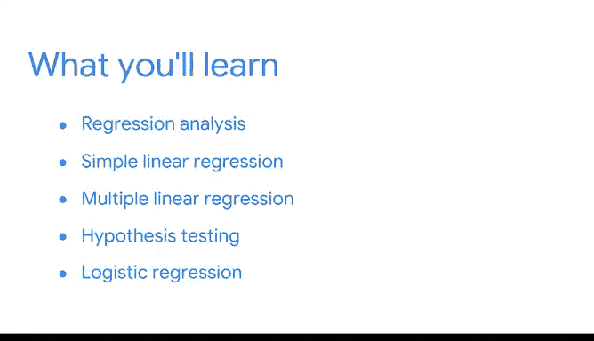

# 谷歌高阶数据分析 5：《回归分析：简化复杂数据关系》regression-analysis（中英双字） - P3：03_01_05_欢迎来到模块1.zh_en - GPT中英字幕课程资源 - BV1Ym4y1L7P7

I can't wait to explore regression analysis with you。 Together。

 we'll learn how data professionals go from a problem to actionable insights using regression analysis techniques。

 We'll begin by introducing regression analysis。 The focus for regression analysis is about understanding relationships between variables。

 We'll use the pace framework。 plan， analyze， construct and execute to guide us through the rest of the course。

 Next， you'll have the chance to apply pace to simple， linear regression。

 which will be our first model we explore comprehensively。😊。

We'll go over the entire process from beginning to end using different scenarios and data。

Then we'll examine multiple linear regression closely。

 Multi linear regression expands upon a lot of the concepts from simple linear regression。

 but will allow us to problem solve a larger variety of questions。

 We will focus on some more nuanced topics， like variable selection and model interpretation。

 We also consider a few hypothesis tests， such as chi squared test and anova。😊。

These tests will help us explore different groups in the data。

 allowing us to glean interesting insights。 Finally。

 we will review the fundamentals of logistic regression。 This is the last and most complex model。

 which will set you up well to approach the rest of the program on machine learning。😊。

Whenever you're ready， I'm excited to get started on the next video。😊。

