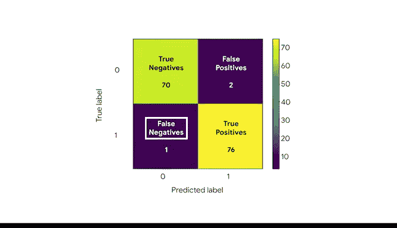

# 谷歌高阶数据分析 5：《回归分析：简化复杂数据关系》regression-analysis（中英双字） - P40：40_05_01_评估二项逻辑回归模型.zh_en - GPT中英字幕课程资源 - BV1Ym4y1L7P7

You have built your first binomial logistic regression。

 You are able to calculate the parameter estimates and graph the logistic regression in this video。

 we'll use the metrics and graphs produced in Python to evaluate how good your model actually was to recap your working with the activity data that measured acceleration and whether or not a person was lying down。

 You previously save the data into training and holdout data sets and the logistic regression model as a variable C LF。

 Now， input the holdout data set into the predicted method to get the predicted labels from the model。

 save these predictions as a variable called Y pre。

 Note that M L predicts a probability that an observation is a 0 or one。

 The predict function from psyit learn actually labels each observation with a 0 or 1 The predict function works by assuming a threshold of 0。

5。 So if M L predicts a value grade。😊，than or equal to 0。5。

 the predict function will label that observation A1。 If MLE predicts a value less than 0。5。

 the predict function will label that observation a0。 The predict proba function on the other hand。

 will allow you to check what probability was predicted for each data point。

Now that you have predictions about whether each observation is a 0 or 1。

 you can create a confusion matrix that will give you a quick overview of how well your model categorize each data point in the holdout data set。

 A confusion matrix is a graphical representation of how accurate a classifier is at predicting the labels for a categorical variable。

 The confusion matrix displays how many data points were accurately categorized by a classifier for each category。

 The other squares in the grid convey how many data points were misclassified。 Now。

 build your own confusion matrix， and together will' review each part of the plot。

 Imsit learns metrics module to create your own confusion matrix。😊，To graph the confusion matrix。

 you can use two methods from the Ma module， Con matrixtri， and Con Ma display。

Use a confusion matrix to generate values for the matrix and save the output as a variable called CM。

Then save the graph as a variable called DisP using the Con matrix display method Now show the confusion matrix by plotting the confusion matrix display functions output。

The diagonal from upper left to lower right displays how many data points were accurately categorized by the classifier for each category。

 The other squares in the grid show how many data points were misclassified on the axes of the confusion matrix。

 There are labels indicating the category of data point as 0 or 1。

0 means the person was labeled as not lying down for that observation。

 data professionals call a data point that is labeled 0 and negative data point。

 One means the person was labeled as lying down for that observation。

 A data point that is labeled one is a positive data point。

 in the upper left corner of the confusion matrix。 We have the count of observation that our classifier predicted as not lying down。

 and they actually were not lying down。 These are called true negatives。 Moving to the lower right。

 We we have our true positives。 This is our count of observations that our classifier predicted as lying down。

 and they actually were lying down。 Now， let's consider where our models's predictions were wrong。😊。

In the upper right is the count of observations where our classifier predicted the person was lying down。

 but they were not lying down。 These were our false positives。

 In the lower left is the count of observations where our classifier predicted the person was not lying down。

 but they were lying down。 These were our false negatives。

In a great model， we should observe a high proportion of true positives and true negatives and a low proportion of false positives and false negatives。

😊，In this video， you learned about the confusion matrix。

 this ver tool can help you add depth to stories you tell about logistic regression models。

In the following videos， we'll discuss even more ways to evaluate the quality of a logistic regression model。

 I'll meet you there。

