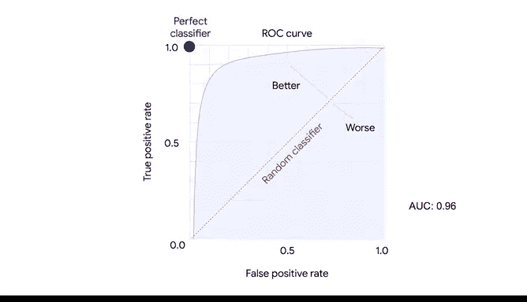

# 谷歌高阶数据分析 5：《回归分析：简化复杂数据关系》regression-analysis（中英双字） - P41：41_05_02_评估逻辑回归结果的关键指标.zh_en - GPT中英字幕课程资源 - BV1Ym4y1L7P7

Earlier， we covered confusion matrices， which helped to visually represent and quantify how well a logistic regression performed。

 In this video， we'll continue to work through the analyze and construct phase of pace and discuss evaluation metrics for logistic regression。

😊，These metrics summarize the true positives， true negatives， false positives。

 and false negatives presented by the confusion matrix。The three metrics we'll discuss are precision。

 recall and accuracy。 You can access the functions used in this video through Psyit Learns metricss module。

And we'll continue to consider our activity data example。

Precision measures the proportion of positive predictions that were true positives。

 Precision is equal to the number of true positives divided by the sum of true positives and false positives。

😊，In this case， precision would tell us among the people we predicted to be lying down。

 how many of them are actually lying down。Psyit Learns metricss library has a convenient function that does the math for us。

 We input the Y values in our holdout dataset set and the y values that our model predicted from the X values in our holdout dataset set。

 Since the range of precision is 0 to 1， a score of 0。97 is great。😊。

Recall measures the proportion of positives that the model was able to identify correctly。

 Reca is equal to the number of true positives divided by the sum of true positives and false negatives。

 Remember that false negatives are those that were lying down。

 but the model did not detect as lying down。 recallca measures the proportion of people。

 the model correctly identified as lyinging down out of the people who are actually lying down。😊。

We input the same data that we input to get precision。

 but using the recall score function from Psyit learnarn， we get a recall of about 0。98。

 And since recall also ranges from 0 to 1， this model performs pretty well。Lastly， we have accuracy。

 which is the proportion of data points that were correctly categorized accuracy is equal to the sum of true positives and true negatives divided by the total number of predictions。

😊，In our activity example， accuracy will measure the proportion of people our model correctly identified as laying down and the proportion of people our model correctly identified as not laying down。

We can use the accuracy score function from Psyit learn。 In this case。

 our model achieved an accuracy score of 0。97， but note that most of the time， precision。

 recall and accuracy are not all this high。 This is to be expected。😊。

Two other common evaluation techniques that may be helpful when working with classifiers are the R O。

 C curve and A U。 These concepts are related to thresholds， true positives and false positives。😊。

Although we use a threshold of 0。5 to generate our predictions。

 sometimes the threshold is determined based on the scenario。

 noticeice that when we decrease the threshold， the true positive increases because we are predicting more observations to be positive。

 but the false positive rate also increases。 The model's true positive rate and false positive rate changes at every threshold。

 with an ideal model。😊，There would exist a threshold where the true positive rate is high and the false positive rate is low。

 We can use an R O C curve and AU to examine how the true positive and false positive rate change together at every threshold。

😊，Data professionals may use ROC curves and AUC when comparing classification models。

 so we'll explore them later in this program。

In this video we covered a number of important metrics these concepts are similar and related。

 don't expect to grasp all the nuances of the content on your first pass。

 allow yourself some extra time and practice to understand how best to apply these measurement tools to support the stories you're telling with data。

Now we'll start constructing the kinds of stories you can share with logistic regression。

