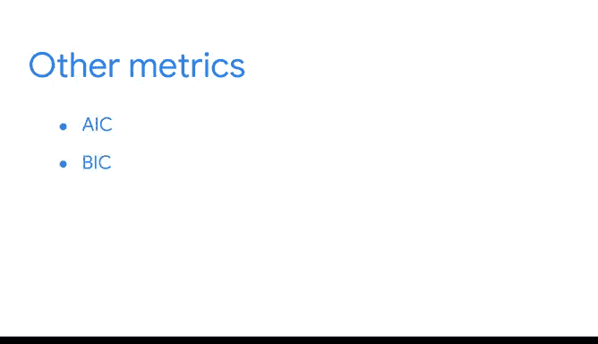

# 谷歌高阶数据分析 5：《回归分析：简化复杂数据关系》regression-analysis（中英双字） - P42：42_05_04_解释逻辑回归结果.zh_en - GPT中英字幕课程资源 - BV1Ym4y1L7P7

So far， we've discussed how to apply pace to logistic regression。

 We've analyzed our data by understanding the model assumptions to the best of our ability。

 ensuring we have a binary outcome variable。 We've constructed our model and created several evaluation metrics。

 Now， we can begin executing and sharing the results。For example， just like linear regression。

 we have coefficients that the maximum likelihood estimation technique found that would best model the data。

 but the interpretation is slightly different。Let's revisit the role of Loit in logistic regression using our example To recap。

 we wanted to understand how changes in vertical acceleration are related to whether a person is lying down or not。

 Our focus now is on what the beta coefficient means in our equation。In this case。

 a one unit increase in vertical acceleration is associated with a beta 1 unit increase in the log odds of P。

But if we exponentiate the log odds， then we can determine how much the odds change as a percentage based on changes in vertical acceleration。

So E to the power of beta 1 is how many times the odds of p will increase or decrease for every one unit increase in vertical acceleration。

We know our coefficient is negative 0。118 from the output。

 and now we can exponentiate the coefficient。E raised to the power of negative 0。118 is 0。89。

We can say that for every one unit increase in vertical acceleration。

 we expect that the odds the person is lying down decreases by 11%。

 This makes sense because if someone is moving faster in a vertical direction。

 they are probably not lying down。Given that we have found a strong predictor of whether a person is lying down or not。

 we can consider the larger picture， for example， classifying motion can help detect falls or suspicions of injury。

Our strong predictor can be a piece of a larger story about providing care to older adults。Next。

 let's examine how the interpretation would change in different scenarios。

Let's try an example where the coefficient is positive， imagine the coefficient is 0。25。

Then we exponentiate and get E raised to the power of 0。25， which is 1。

28 rounded to the nearest 10th。Then we could say that for every one unit increase in x。

 we expect the odds of y being1 to increase by 28%。Now， imagine there are other factors in the model。

 such as acceleration in other directions。 when there are multiple independent variables in a logistic regression model。

 just like in a linear regression model， we have to report coefficients while holding other variables constant。

😊，So we could say， for every one unit increase in x， holding other variables constant。

 we expect the odds of y being1 to increase by 28%。Moving beyond the coefficient。

 it is always helpful to state the P value and confidenced interval to give additional information about how likely the result is just by chance。

PsyCitLear does not have a built in way of getting P values or confidence intervals。

 but stats models does。This is a great example of how different tools and packages can give you different kinds of information。

As a data practitioner， you have to choose your tools depending on your priorities。

When presenting the results it can be helpful to include a confusion matrix and some statistics on precision。

 recall， accuracy and or ROCUC， however， depending on the situation you might want to include all of them or focus on a subset of metrics。

Consider that certain industries or organizations may have preferred metrics given how they manage their modeling process。

 It's important to check with your team about this as you get started as a data analytics professional。

Take， for example， the case of detecting spam text messages。

 spam texts are unsolicited messages sent to many recipients。

 Only a small fraction of text messages that you receive or probably spam。

 But if your goal is to accurately classify spam text messages so you don't give away private information or click on a bad link。

 Then you're really only focusing on how well you can detect spam messages。 In fact， in this case。

 accuracy is not a good metric。 Let's say only 3% of text messages or spam。

 That means 97% are text messages you want to receive from friends and family or automated messages from service providers。

😊，So if a model predicts that 100% of messages are not spam。

 that model would have a 97% accuracy rate， which seems great。

But it's not that good in this context because the model will not have detected any spam at all。

 even though 3% of messages are in fact spam。In the case of spam messages。

 recall is probably a more meaningful metric recallcall will tell us the proportion of spam messages that the model was actually able to detect。

Precision， on the other hand， would tell us the proportion of data points labeled spam that were actually spam。

Precision essentially measures the quality of our spam labeling。

There are other metrics that you can explore as well， such as AIC and BIC。

 which can help determine how good a model is while factoring in how complex the model is。

As with many of the topics covered in this course， we've reviewed many concepts and now understand the terminology associated with the material work in the data space is dynamic。

 There is no one solution that works every time。 Data professionals are constantly learning and thinking about better approaches。

 We always have to contextualize the data， the problem and the available solutions。

Next up we'll focus on comparing some of the models and tests you've learned so far， meet you there。

