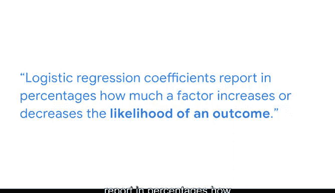

# 谷歌高阶数据分析 5：《回归分析：简化复杂数据关系》regression-analysis（中英双字） - P43：43_05_01_用回归模型回答问题.zh_en - GPT中英字幕课程资源 - BV1Ym4y1L7P7

You've learned a lot about binomial logistic regression and the kinds of problems that can help you solve。

 Now， you'll review some of the other techniques that you've learned and focus on the kinds of questions you might encounter in your work as a data professional。

So far， you've learned about linear regression models， hypothesis testing。

 specifically chi squared tests and AO variant， and logistic regression。

You've also used the pace framework， plan， analyze。

 construct and execute to help guide your work you started with the plan phase to understand which needs were being prioritized。

Based on the questions being asked and the data you had access to。

 you determine which models or tests would be most appropriate。Let's consider an example。

 Imagine you're a data professional at a recording studio。 You have a team meeting。

 and the conversation is about the number of times each song is streamed。

 Some questions that come up include what factors influence the number of music streams and how much does each factor influence the number streams。

Since the number of music streams is the outcome variable。

 and the number of streams is a continuous variable。

 you could consider linear regression or hypothesis testing。

 but because the question asks about how much each factor influences music streams。

 linear regression is a better model to answer the question。

Remember that linear regression allows for accessible interpretation of the coefficients and r squared to help explain which factors impact the outcome variable and by how much。

But you want to make sure that the model assumptions are met to add validity to your conclusions and insights。

Let's consider another example。 Imagine you are working for a cafe。

 Theyre sampling different coffee beans from different countries and want to figure out which kinds of coffee beans sell better。

 The team is put together some projections about how they expect the beans to sell。

 but they are curious if the bean sales are independent of their pastry sales。

 The country of origin of the beans is a known differentiator。

 The pastry sales would be more of the covariate。 In this case， although the outcome variable。

 sales is still continuous， the focus of the question is about comparing different groups。

 such as different kinds of coffee beans and different countries of origin。Therefore。

 you should focus more on hypothesis testing， which can be a great way to conduct A B tests。

The null hypothesis would be that the cafe sells approximately the same number of bags of each coffee bean type。

 The alternative hypothesis would be that the cafe does not sell the same number of bags of each coffee bean type。

By conducting a series of tests， you can either accept or reject the null hypothesis with a particular P value to help understand how well the model explains the trends。

And the team will be able to better understand which beans to order to sell more coffee at the cafe。

Let's consider one last example in which you're working at a social media company and you're interested in exploring why some posts do or do not go viral。

 You decide on a question， how can I predict whether a post will go viral since the outcome variable is binary。

 Either the post go viral or does not Biomial logistic regression might be the first model you consider。

The best way to determine if a logistic regression is the right choice is to build and evaluate the model。

 Luckily， there are many metrics you can use， including P value， Con matrices， precision， recall。

 accuracy， R O C， A U， AI C and B， I C， choosing the best metrics will depend on the situation。

 When interpreting the coefficients for logistic regression models。 Remember to exponentiate them。

 recall that when sharing results， logistic regression coefficients report and percentages。

 how much a factor increases or decreases the likelihood of an outcome。😊。

As a data professional， you will encounter many different questions that require a variety of approaches to address by focusing on the fundamentals of what each model does well。

 you'll be able to find ways to put these tools into practice。

