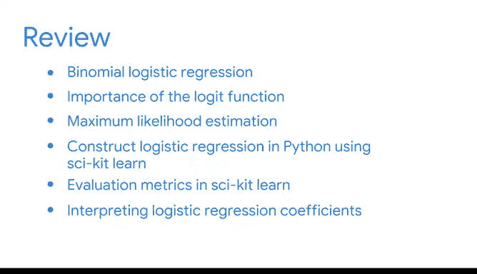

# 谷歌高阶数据分析 5：《回归分析：简化复杂数据关系》regression-analysis（中英双字） - P44：44_05_01_总结_5.zh_en - GPT中英字幕课程资源 - BV1Ym4y1L7P7

We've arrived at the end of the course。 Congratulations。

 You should be proud of how much you've learned and can apply to your work as a future data analytics professional。

 Before we finish， let's review what you've learned。

 We've defined binomial logistic regression as a foundational data technique used to model the probability of one or two outcomes occurring in learning about binomial logistic regression。

 we focused on the importance of the logit function。

 both as an assumption of logistic regression and in terms of how to interpret the results。😊。

You learned about maximum likelihood estimation， a common technique for estimating the best parameter for maximizing the likelihood of observing the data used to build a logistic regression model。

Then you learned how to construct a logistic regression model in Python using the Psyit Learn library。

 Lastly， you considered some evaluation metrics， including confusion matrices， precision。

 recall and accuracy。PsyitLn has many convenient functions that can help you evaluate and interpret a logistic regression。

But sometimes you'll need other Python libraries or packages。 For example。

 it can be helpful to go to Stats model， which you used when learning about linear regression。

 Kai squared and anova testing。Python packages， like regression models have their own strengths and weaknesses。

 Your ongoing experience as a data professional will help guide you to the tools that's most appropriate for each situation。

😊，You also learned how to interpret logistic regression coefficients and what considerations to make when selecting metrics and plots based on the questions you're trying to answer。

Lastly， you reviewed example scenarios to figure out why certain models or tests might be most appropriate in each situation。

You've worked very hard up to this point。 Crate all that you've learned and consider the many questions you've asked and answered throughout this learning journey。

You're well on your way， so keep up the good work。

