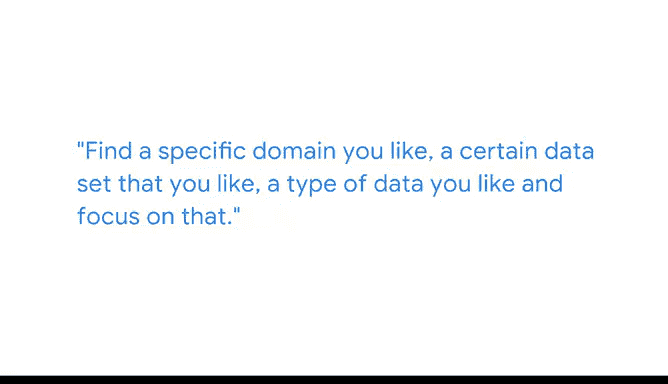

# 谷歌高阶数据分析 5：《回归分析：简化复杂数据关系》regression-analysis（中英双字） - P46：46_06_02_Leah-分享模型和建模技术的策略.zh_en - GPT中英字幕课程资源 - BV1Ym4y1L7P7

Hi， I'm Leah， I'm a data architect and I work on data models for data scientists and data analysts to use to find insights into data I have a very untraditional background I didn't come from computer science or anything like that I studied sociology and philosophy in France actually and then I came back to the US and got a job as a knowledge engineer and that actually introduced me to this knowledge engineering space when interviewing for a job。

 it's really important to talk about the data models that you've worked on and to present them in such a way that you can explain in a concise manner to your interviewer what you've done when you are presenting your data models in your data modeling experience you can talk about the problem that you're solving for the techniques that you've used and how exactly you。

s it to the stakeholders， which is a huge step， take the projects。

 the artifacts that you're getting from this course。

 as well as think about other things that you're really passionate about and go ahead and build a website or a Jupyter notebook or a GiHub page or something like that that you can share a link to is really important。

When I've conducted interviews in the data analytics space， I love to see。

Websites and GiHub links and certificates and other things that show me that they have worked on other projects。

 even outside of work， that they're very passionate about and they want to share and I can go to their website and I can see a project that is well presented where they explain at a high level the concept that they're working on or the problems that they're solving for and then work their way down to get into more detail。

 find specific domain you like， a certain data set that you like type of data you like and focus on that I notice I get very excited about my passion projects and I feel like theyre a little I work a little more on them and that helps me to really push through and make it exciting because I'm excited about it。

