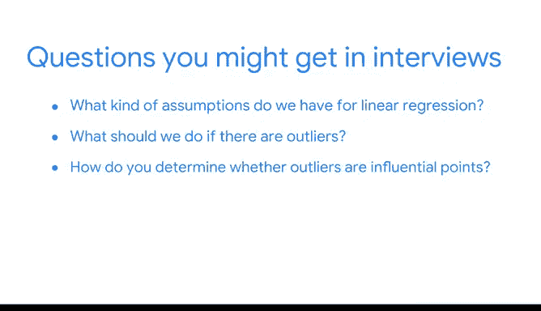

# 谷歌高阶数据分析 5：《回归分析：简化复杂数据关系》regression-analysis（中英双字） - P48：48_06_01_期末项目总结与持续职业成功建议.zh_en - GPT中英字幕课程资源 - BV1Ym4y1L7P7

Hello again。I'm back to check in on how you're doing with your progress so far。

 You've already accomplished so much In addition to the A B test you built and analyzed the tidy data set you organized and the data visualizations you composed。

You've also built a multiple linear regression model。

Taking a moment to reflect on each of our portfolio projects creates an opportunity to really acknowledge everything you've learned。

 practice and accomplished up to this point in the program。😊。

These projects are collectively preparing you for future interviews as you begin to navigate the data career space。

 and your pace strategy document has notes for you to refer to about your process。

 considerations and steps for completing these artifacts in your portfolio。

This is all stuff you'll want to discuss with potential employers and hiring managers during interviews。

So far， you identify the importance of understanding assumptions for linear regression。

 You practice evaluating models， and you have been taught to recognize the importance of explaining your process when working with regression models。

As you begin preparing for interviews， you'll want to think about questions you may be asked like。

 what kind of assumptions do we have for linear regression。 What shall we do if there are outliers。

How do we determine whether outliers are influential points？

How do you check multicolineity and what should be done if there is multicolineity， Of course。

 there will be additional questions for you to answer in your interview。

You might even find yourself in a situation where potential employers and hiring managers ask you to describe how you would approach a project that you have little to no domain knowledge about。

This portfolio project required you to assess a unique business scenario。 In response。

 you built a multiple linear regression model with Anova testing。

In addition to showcasing your modeling skills， you also demonstrated your ability to communicate findings effectively in your professional write up。

 which included data visualizations， evaluation and interpretation of the model and key business insights。

Coming up， you're going to learn all about machine learning models。

 Then you'll have an opportunity to solve a problem by building your own。

You're doing a great job putting together your portfolio。

