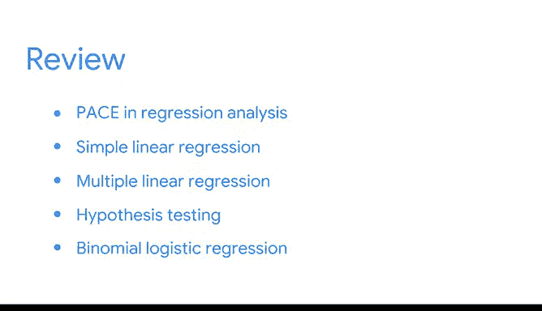

# 谷歌高阶数据分析 5：《回归分析：简化复杂数据关系》regression-analysis（中英双字） - P49：49_06_03_课程总结.zh_en - GPT中英字幕课程资源 - BV1Ym4y1L7P7

Congratulations on reaching the end of this course。 Incredible work。

 I hope you take a moment to celebrate and reflect on everything you've learned and accomplished throughout this course and the program overall。

 you began by applying the pace framework plan， analyze。

 construct and execute to modeling relationships between variables and learning about two fundamental models。

 linear and logistic regression。 Then you learned how to check assumptions， and to construct。

 evaluate and interpret a simple linear regression model using examples。

 you were able to practice your python and modeling skills on real data to。

 you extended your understanding of simple linear regression concepts which you applied to multiple linear regression。

 with more variables， The interpretation became more complex。

 and the number of considerations increased。 However。

 the scope of questions you could ask and answer also expanded。 Next。

 you turn your focus to categorical variables with hypothesis testing。 you learned aboutis。😊。

qua and a Nova testingThis allowed you to ask questions about how groups differed from one another。

Finally， you learned about binomial logistic regression。

 which focuses on the probability of a particular outcome。

 I hope you're proud of every line you've coded in every question you've asked。

 Being able to talk about and apply concepts we covered will serve you in whichever industry you work and the roles you take on the rest of your data analytics career。

😊。

You now have a much vast skill set that includes regression models， evaluation metrics。

 and hypothesis testing。As you move through the rest of the program。

 you'll be able to draw connections using statistics and regression modeling。 In the next course。

 you'll learn from Ssila， a fellow Googler about the machine learning landscape。

 You'll explore supervised and unsupervised machine learning。 I can't wait for you to meet Susila。

 And for all， she has to teach you。 You'll learn a lot of new and interesting techniques and solve problems with big data。

 I' am so grateful I could be here with you on your regression journey。

 I hope you feel more confident about your data professional knowledge and are prepared to keep developing your skills。

😊，Youre ready to continue to the next step of your career as a data analytics professional。

