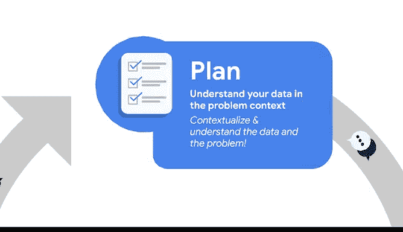
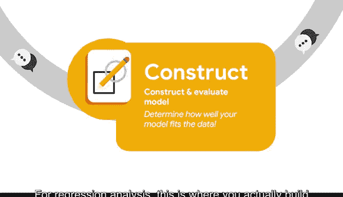
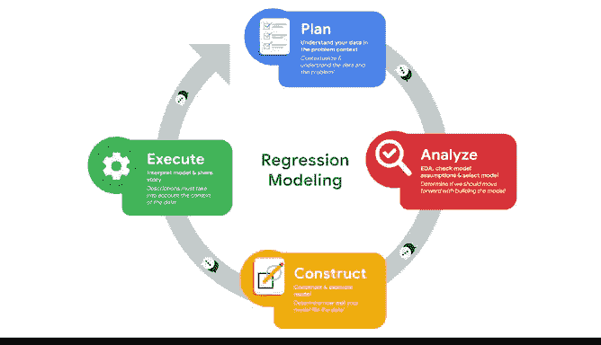
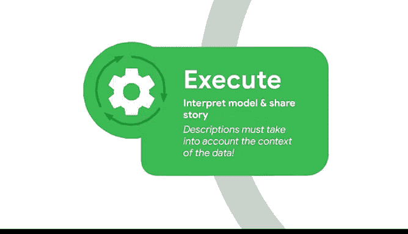

# 谷歌高阶数据分析 5：《回归分析：简化复杂数据关系》regression-analysis（中英双字） - P4：04_01_06_回归分析中的节奏.zh_en - GPT中英字幕课程资源 - BV1Ym4y1L7P7

You may be familiar with terms like machine learning models or regression analysis。

 and if not you're in the right program Next up we'll get started on our learning journey。To begin。

 we're going to discuss a few key terms and definitions。

 regression models are based on a statistical foundation models used in the data career space are a family of techniques that rely on existing information or data points to inform what we might think other data points will look like。

The goal is always to tell a story about the relationships between the variables and the data。

 the story will help stakeholders adjust their business strategy and decisions。

Moodeling follows an iterative process。 You may be familiar with other frameworks。

 such as the data lifecycle or the six steps of exploratory data analysis。 In this course。

 we will cover each step of the modeling process using pace outlined earlier in this program。

 Pace plan， analyze， construct and execute， provides us with the foundation for conducting regression analysis。

 Let's take some time to preview how pace works in the context of regression analysis。

In regression modeling， the plan stage is about understanding your data in the problem context。

 knowledge you bring， whether from industry or others can be instrumental in the plan stage by considering what data you have access to how the data was collected and what the business needs are。

 You'll be able to strategically analyze， construct and execute the rest of your work。

 The plan stage will guide the other three stages of pace。

After you plan， you have to analyze in this stage， you examine your data more closely so you can choose a model or a couple of models you think might be appropriate。

When working with regression analysis， this is where you use Python to perform EDA and check the model assumptions as needed。

 Model assumptions are statements about the data that must be true to justify the use of particular data techniques。

 As a data professional， you will use statistics to check whether model assumptions are met。

 A good understanding of statistics， gives data professionals the power to construct meaningful models。

 After you analyze， you must construct for regression analysis。

 this is where you actually build the model in Python or your coding language of choice。

This step involves selecting variables， transforming the data as needed and writing code。

 Even though you checked model assumptions before you built the model。

 many model assumptions need to be rechecked after the model is built。

 So you'll do that in the construct phase as needed。

 The last part of construct phase is evaluating the model results。 At this point。

 you are answering the questions。 How good is my model。 You'll choose metrics。

 compareare models and get preliminary results。 Then based on your evaluation。

 you can use E D to refine your model accordingly。

Of course， as a data professional， you must， first and foremost， be an honest storyteller。😊。

Studying the results produced by the regression will uncover relationships within your data and help you discover insights to tell the full story。

 This leads to the last part of pace。 Ex。 You'll interpret everything you learned from analyzing and constructing to share the story。

 You'll prepare formal results and visualizations and share them with stakeholders。😊。

To do this， you'll convert model statistics into statements。

 describing the relationship between the variables in the data。

 These descriptions must consider the context and initial questions from the plan phase。

At the center of everything is data， and the pace framework helps data professionals stay organized。

 The insights data professionals produce must be data driven and accurate。

 and they have to make sense， given the business or community context。

We'll go over these steps using examples later in the course， but pace is iterative。

As you grow as a data professional， your experience will help you decide when to pivot between stages of pace。

 you might switch the order or repeat steps depending on the situation。

Now that we've laid out the pieces of the modeling puzzle。

 we can talk about how correlation and regression are related。

 Then we will explore two foundational regression models， linear and logistic regression。

 These models will be covered in more depth in later videos。

 This overview will provide you with a solid basis of understanding。😊。

Time to start putting together our puzzle。 Don't forget your statistical grammar tools。

 You'll need them。