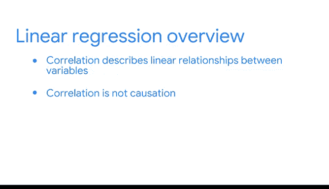

# 谷歌高阶数据分析 5：《回归分析：简化复杂数据关系》regression-analysis（中英双字） - P5：05_01_01_线性回归介绍.zh_en - GPT中英字幕课程资源 - BV1Ym4y1L7P7

Previously， we learned that regression analysis is about estimating relationships between a single dependent variable and one or more independent variables In this video we will discuss our first modeling technique linear regression。

Many patterns that you've observed in daily life can be expressed using linear regression models。

 which is pretty cool。 For example， as a version of computer software gets older。

 online searches for that software version may decrease。

As a social media personality gains followers， their book sales increase。

These relationships can be modeled using a linear regression The linear in linear regression indicates the kind of relationship we can visualize on a graph。

 a line。A line is a collection of an infinite number of points extending in two opposite directions In a graph。

 the individual points show up as a line， and we only see a portion of the line。

 Linear regression is a technique that estimates the linear relationship between a continuous dependent variable Y and one or more independent variables。

 X。 For example， we could model the relationship between the prices of a product and the number of sales。

 Our y variable would be the number of sales， and our x variable would be the prices。

In an earlier course， you learn the difference between continuous and categorical variables as a reminder。

 continuous variables are variables that can take on any real value between its minimum and maximum value。

For example， product sales， vehicle speed and time spent on a webpage are all continuous variables。

Whereas types of products and educational level are not。

 these are categorical categorical variables have a finite number of possible values。

While linear regression allows us as data analytics professionals to estimate continuous dependent variables。

 there are other regression models that let us estimate categorical variables。

 We'll learn more about those in a later course。Throughout this course。

 we'll talk about dependent and independent variables。

 The dependent variable is the variable a given model estimates。

Sometimes the dependented variable is also called a response or outcome variable and is commonly represented with the letter Y。

We assume that the dependent variable tends to vary based on the values of independent variables。

 typically represented by an x。Independent variables are also referred to as explanatory variables or predictor variables。

For example， let's say you're working at a cake shop and you're trying to understand the factors that contribute to cake sales。

The dependent or Y variable would be the number of cake slices sold on any given day。

An independent or X variable could be how many cups of coffee are sold that day。

Maybe as more coffee is purchased， more cake is also purchased in linear regression you might encounter two more terms。

 slope and intercept。The slope refers to the amount we expect Y。

 the dependent variable to increase or decrease per one unit increase of x， the independent variable。

The intercept is the value of y， the dependent variable， when x， the independent variable equals 0。

Going back to cake and coffee， the slope would be how many slices of cake are purchased per cup of coffee purchase。

 The intercept would be the number of cake slices that are sold when 0 cups of coffee are sold。

When two variables， x and Y are related in a linear way， we say they are correlated。Using statistics。

 we can actually calculate how strong the linear relationship between X and Y is pretty cool。

There are two kinds of correlation， positive and negative positive correlation is a relationship between two variables that tend to increase or decrease together。

For example， as more cups of coffee are purchased， more cake slices are purchased。 Ne correlation。

 on the other hand， is an inverse relationship between two variables。 When one variable increases。

 the other variable tends to decrease。And the reverse is true too。For example。

 let's say you're still working at the cake shop and you're estimating how often to refill the iced coffee dispenser。

You can model the relationship between iced coffee and hot coffee sales。As hot coffee sales increase。

 you might notice ice coffee sales tend to decrease。

 or perhaps you're working at a media company and you're analyzing readership。

As the length of news articles increases， the number of people that finish reading the article might decrease。

 this is also an example of negative correlation。Identifying these kinds of relationships can be incredibly useful in the workplace and in everyday life。

Determining linear relationships helps us answer questions such as which factors are associated with an increase or decrease in product sales。

Which factors make a social service providers increase resources in a given region。

 which factors lead to more or less demand for public transportation？In the cases mentioned。

 how big the slope of the regression is tells us how much sales， resource allocation。

 and public transportation increase or decrease。Using linear regression you can help answer similar questions in any industry。

 however， it is important to note that correlation is not causation for example， in your cake shop。

 people buying coffee does not cause cake sales to increase when modeling variable relationships a data scientist must be mindful of the extent of their claims causation describes a cause and effect relationship where one variable directly causes the other to change in a particular way。

Proving causation statistically requires much more rigorous methods and data collection than correlation。

For a data professional， the distinction between correlation and causation is especially important when presenting results。

 For example， although we can say that as someone gets older。

 the number of places they have visited tends to rise。

 we cannot necessarily say that someone's age causes the number of places they have visited to increase。

There could be other factors causing you to travel more that coincide with your aging。

 such as visiting family or traveling more for work。

 any of these factors could be correlated to aging。

 but it's hard to say whether age or other factors are causing the traveling。

Articulating that correlation is not causation is part of a data professional's best practices and ethical toolbox。

Both correlational and causal relationships provide useful insights。

 regressionion analysis helps data analytics professionals tell nuanced stories without needing to prove causation。

That concludes a high level overview of your first modeling technique to recap linear regression is a way to model linear relationships。

Depenent variables vary according to independent variables。

The slope identifies how much the dependent variable changes per one unit change in the independent variable。

 positive and negative correlation describe linear relationships between variables。

Always be mindful when interpreting regression results correlationrelation is not causation。

There are lots of linear relationships in the world and in industry。In this video。

 we've provided just a few examples， but there are plenty more。That's all for now。

 next we'll address the math behind linear regression。

 your ever growing statistical foundations will help you explain regression results in the clearest way possible。

