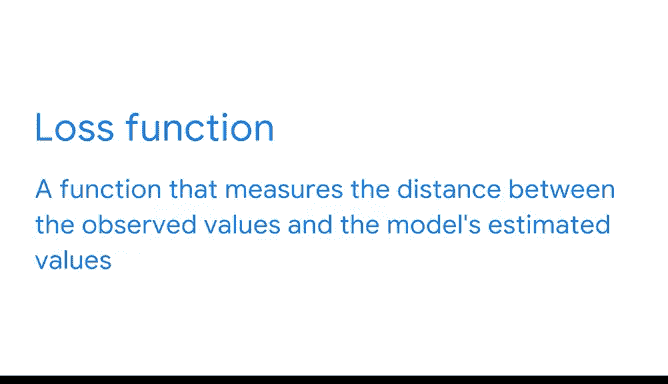

# 谷歌高阶数据分析 5：《回归分析：简化复杂数据关系》regression-analysis（中英双字） - P6：06_01_02_线性回归的数学原理.zh_en - GPT中英字幕课程资源 - BV1Ym4y1L7P7

In an ideal world， you would want every data point relevant to the question you are trying to answer In a previous course。

 you learned that data professionals describe this as population。

 Let's imagine you're working for a publishing company。

 You want to understand the relationship between an author's social media following and their book sales。

You would need data on every book author， social media follower account and every book sale of all time。

 This is an impossible task。 But luckily， you don't actually need an entire population to run meaningful regression analysis。

 You can get a reasonable estimate with a representative sample。

 A sample is a part of the population， which is just the statistical way of saying a sample is some of the data you could possibly have。

😊，If you have a set of sample data， each data point can be represented with its own set of attributes or X and Y values。

 In that case， the sample does not contain all possible values from the population of data。

The observed values or actual values are the existing sample of data。

 Each data point in this sample is represented by an observed value of the dependent variable and an observed value of the independent variable。

In the publishing company example， the dependent variable is book sales。

 and the independent variable is how many followers the author has on social media。

An observed value you might have in your dataset set would be X， or number of followers equals 10000。

 and Y or number of book sales equals 500。 The goal of the regression analysis is to define a relationship mathematically between the sample Y and X's to understand how the two variables interact。

You can imagine that at every x value， there are many possible values that y could take on to simplify this understanding。

 linear regression analysis focuses on the mean of y， given a particular value of X。

This mean of y is the value on the line in a linear regression and is denoted with a Greek letter that looks like a lowercase M。

 You can remember M is for mean。 The Greek symbol is mu。As described previously。

 in order to define a linear relationship， we need a slope and an intercept。In statistics。

 we write the intercept as beta 0， which we sometimes call beta not。

 And the slope is written as beta 1。Mu of y and the betas are sometimes called parameters。

Parameterters are properties of populations and not samples。

 so we can never know their true value since we can't observe the whole population。

But we can calculate estimates of the parameters using our sample data。

To differentiate between the population parameters and the estimates of the parameters。

 we denote the estimates with a hat。The calculation is beta 0 hat。

 beta 1 hat and mu hat are all parameter estimates。

Although it's valuable to recognize the mu notation for the remainder of this course。

 we'll use a simplified notation。 Y equals beta 0 plus beta 1 times x。 For example。

 let's say that we estimate beta 0 as negative 1 and beta 1 as 5。Now， let's input some values for x。

 If x equals 0， we get negative 1， which is the y intercept or beta 0。 If x equals 1。

 we get y equals 4。 If x equals 2， we get y equals 9。 If x equals 3， we get y equals 14。

 from just four data points， a pattern emerges。For every one unit increase in x。

 we give a five unit increase in y。 Remembering our equation，5 is our slope or beta 1。

 The slope tells us how much y increases for every one unit increase in x。

 These estimated betas are also called regression coefficients。😊。

So now whenever you see the hat symbol， you'll know that you are estimating betas。

 also known as regression coefficients。In the prior formula。

 the regression coefficients were the slope and intercept。

 They described the linear relationship found in the sample data。

In order to enter values of x and get estimated values for y。

 we assumed that beta 0 was negative 1 and that beta 1 was 5。

But how did we arrive at those regression coefficients？

One of the most common ways to calculate linear regression coefficients is ordinary least squares estimation。

 or OLS for short。We will go over the math behind OLS later in the course for now， though。

 let's discuss an overview of how OLS works。In linear regression analysis， we， as data professionals。

 are trying to minimize something called a loss function。

 The loss function is a function that measures the distance between the observed values and the model's estimated values。

 Theoreically， we could draw an infinite number of lines that model the data we have。😊。

But we don't want to find just any line， we want to find the best fit line。

 so we want to minimize the loss function。With this foundational understanding of how linear regression works。

 we will be able to talk about pace in linear regression analysis， which we addresseded earlier。

Later in the course， we'll build on the concepts we covered in the video to learn more about how regression works。

 when to use linear regression， its variance， and OLS and Python。

