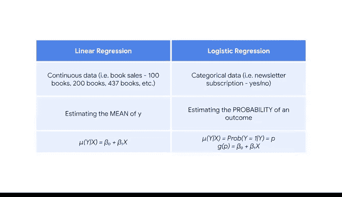

# 谷歌高阶数据分析 5：《回归分析：简化复杂数据关系》regression-analysis（中英双字） - P7：07_01_01_逻辑回归介绍.zh_en - GPT中英字幕课程资源 - BV1Ym4y1L7P7

I still remember being on a sports team， needing to determine which team first played offense or defense using a coin toss。

What's the chance the coin will come up heads。 What's the chance the coin will come up Tas。

 The probability of either event occurring is 0。5 or 50%。This is a classic probability problem。

 but in the field of data analytics， we get to use a technique called logistic regression to model much more complex probability problems。

For example， what factors lead to someone subscribing or not subscribing to a newsletter？

Under what circumstances does someone comment on an online video or social media post？

Given certain factors， how likely is it that someone renews their membership to an organization？

All of these questions are tackling discrete events or categorical data。

There are a specific set of possible outcomes， subscribe or don't subscribe。

 comment or don't comment， renew or don't renew。To answer these kinds of questions。

 data professionals use a model called logistic regression。

Logistic regression is a technique that models a categorical variable based on one or more independent variables。

The dependent variable can have two or more possible discrete values。

 Let's say that your company has a newsletter and is interested in increasing readership。

On the company website， users have the opportunity to subscribe to the newsletter。

One factor related to the newsletter subscription could be how many minutes the user spends on the web page before leaving。

Our dependent variable Y has two possibilities。Users don't subscribe。

 which will represent with a zero or users do subscribe， which will represent with a one。

Our independent variable X is continuous and measures how many minutes the users spend on the web page before leaving。

Let's graph the hypothetical data on a scatter plot like we would when doing EDA or exploratory data analysis。

 we can observe that the data points are roughly in two horizontal lines。

The higher one indicates the user subscribed。 This is when y equals 1。

The lower one indicates that the user did not subscribe。 This is when y equals 0。

 The X access indicates how long the user was on the site in minutes。

 Since the relationship between X and Y is not just a straight line。

 we need a new mathematical way of expressing the relationship between X and y。

Lgister regression will allow us to model the probability a user will subscribe to the newsletter。

The key concept is that the mean of y given x is equal to the probability of y equals 1 given x。

Let's explore this idea。At this point， our observed y values are just a bunch of zeros and ones to find the mean we would sum all of our observations and then divide the total by the number of observations。

Because some of the observed data are zeros， when summing the observations。

 the zeros all add up to 0。 Therefore， the sum of all the observations is equal to the total number of ones。

Then we divide by the total number of observations。

 this is equal to the probability of y equaling1 or someone becoming a subscriber。In this case。

 we know that the mean of y given x is equal to the probability of y equaling a certain outcome given x。

 sometimes the probability of y given x is written as P to reinforce the idea of probability。

To help you remember， you can think P is for probability。 Now。

 we want to understand what variables help explain those probabilities。Mathematically。

 we need a way to relate the X variables to the probability that y equals1。

Imagine we only have one independent variable， so then we need to relate the probability of y equals 1 to beta 0 plus beta 1 times x。

In logistic regression， we use a link function to express the relationship between the x's and the probability that y equals some outcome。

A link function is a nonlinear function that connects or links the dependent variable to the independent variables mathematically。

We will discuss how logistic regression and link functions work in more detail later on， but for now。

 just know that this is an example of the differences between linear and logistic regression models。

Let's review a few more similarities and differences between modeling approaches。 First。

 linear regression involves a y that is continuous， like book sales。

 While logistic regression involves a why that is categorical， like newsletter subscription。

Choosing one model over the other is about the kind of data you have。

You can answer similar questions about what factors impact and outcome of interest。Secondly。

 since linear regression models a continuous variable， we're estimating the mean of y。

But logistic regression models a categorical variable。

 so we're modeling the probability of an outcome。 for example， if y equals1 or if y equals 0。Lastly。

 for linear regression， we can express Y directly as a function of X。But for logistic regression。

 we need a link function to connect the probability of Y with X。

We'll continue focusing on logistic regression with just two categories like the subscription problem。

 but there are more complex version of logistic regression that can model multiple outcomes or categories such as types of skinca products people buy or types of services that people receive。

In this video， we covered the basics of logistic regression。

 We also compared and contrasted linear and logistic regression models。

 Later in this course we'll cover an estimation technique for logistic regression called maximum likelihood estimation。

😊，And we'll uncover a bit more of the math。For now。

 know the computers are incredibly powerful and enable us as data practitioners to focus less on the math and more on the storytelling。

The rest of the course will provide you with a solid understanding so you know what's going on in that powerful machine of yours。

