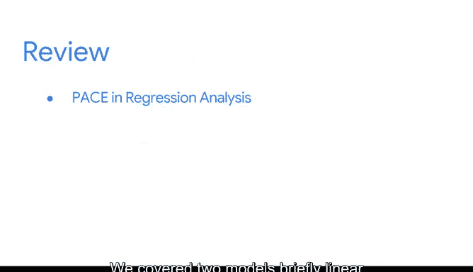

# 谷歌高阶数据分析 5：《回归分析：简化复杂数据关系》regression-analysis（中英双字） - P8：08_01_01_总结_1.zh_en - GPT中英字幕课程资源 - BV1Ym4y1L7P7

Together， we've covered a lot of high level regression concepts already。

 You should be proud of yourself for learning all of these new concepts。

 It's been incredible starting you off on your regression journey。😊，In prior courses。

 you learned about the data career space， the importance of communication in data driven work。

 Considerations for how data is cared for the value of Python programming as a data tool。

 E D and statistics， In this course， we've started connecting these concepts together to prepare you to build your first models。

So far， we've talked about pace and regression analysis。

 Planning allows you to consider how the data was collected and what the business needs are in a particular instance。

 in the analyze phase， you perform EDA， which helps you determine whether one model is more suitable than another when constructing your model。

 you'll be amazed by the power of your computer and the Python programming language。

Through model construction， you'll apply your creativity as you visualize your data and regression models as well。

You'll then rely again on statistics and math to evaluate any model you encounter Finally。

 in the execute phase， you have to focus on communication as you interpret the results of your model。

By combining the four steps of pace， you'll start creating data driven stories soon。

We covered two models briefly， linear regression and logistic regression。

These models are able to estimate common relationships between variables that we observe in our personal and professional lives。

Regression models help us answer questions about what factors are associated with a variable of interest and by how much。

The data always leads us to the questions we can ask and answer。Linear regression needs a continuous。

 dependent variable so it can help model anything measurable and quantifiable。

Logistic regression needs a categorical， dependent variable。

 so it can determine the probability of something occurring。

Linear regression focuses on positive correlation variables that increase or decrease together or negative correlation。

 One variable goes up and the other goes down。 Logistic regression models use a link function to relate the X's and the categorical Y。

Later， we will learn how to use estimation techniques in Python with real data and we'll go through more use cases of regression。

Although you will encounter many formulas along the way。

 keep in mind that the end goal is to figure out the story the data is trying to tell。

You have many resources available to you in this course。

Good luck with the rest of the section and be patient with yourself。 I'm thrilled to join you again。

 next time。😊。

