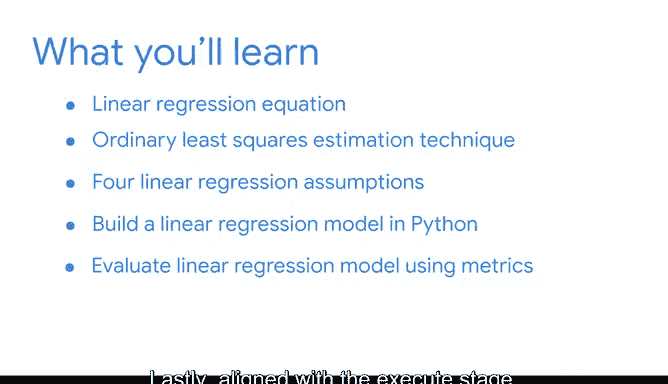

# 谷歌高阶数据分析 5：《回归分析：简化复杂数据关系》regression-analysis（中英双字） - P9：09_02_01_欢迎来到模块2.zh_en - GPT中英字幕课程资源 - BV1Ym4y1L7P7

Welcome back to Google's course on regression models。 It's great to be with you again。Previous。

 we provided a high level overview of regression analysis and two core foundational regression models。

 linear and logistic regression。😊，In this section of the course， we'll go over how to set up， build。

 evaluate and interpret our first regression model。 We'll also review model assumptions。

 construction， evaluation and interpretation， as we've previously defined。

 there are a lot of new concepts so if you ever need to get reorganized， remember the pace framework。

 plan， analyze， construct and execute。Each part of pace aligns with a part of the process of regression analysis。

 Sometimes we have to repeat some steps， but these are the phases to keep in mind and we'll go through the process concretely together using examples to help guide you。

To recap， linear regression is a technique that estimates the linear relationship between a continuous dependent variable and one or more independent variables。

Recall that an independent variable is the variable whose trends are associated with the dependent variable。

 Independent variables are commonly represented by the letter X。 Meanwhile。

 the dependent variable is the variable that a given model estimates。

 also known as the outcome variable。The dependent variable is commonly represented by the letter Y。

 We'll learn more about simple linear regression。 Simple linear regression is a technique that estimates the linear relationship between one independent variable。

 X and one continuous dependent variable， Y。The model assumptions， code， evaluation metrics。

 and interpretation skills we review here will extend directly into more complex models like multiple linear regression。

By solidifying your foundation through simple linear regression。

 you'll be prepared to tackle advanced models that can answer more complex questions in different industries and business contexts。

As we go through simple linear regression together， you'll combine many of your prior skill sets。

 including Python programming， exploratory data analysis， or EDA， and statistics。

These tools will allow you to construct a simple， linear regression model that can help you influence strategy and decision making in any company or organization。

The key terms， activities， and learning resources that we explore together in these videos will also be important in the rest of this course。

 which will refer back to our discussions of simple linear regression。Together。

 we'll go through all the stages of pace while learning regression modeling。

 we'll first review the linear regression equation and then learn about estimating parameters using ordinary least squares。

Then we'll define each of the four key assumptions of simple linear regression as for the analyze stage。

 we'll use Python and EDA to verify if our data meets these assumptions。In the construct stage。

 well build your first regression model in Python together。

 You'll also have opportunities to practice both Python and ED on your own as well。

 We'll also learn several evaluation metrics and a technique to help you quantify how good your model is。

 Lastly， aligned with the execute stage。 We'll use our metrics to practice interpreting our results for stakeholders and non technicalchnical audiences。

😊。

I'm so excited to get started on simple linear regression modeling， so let's begin。

