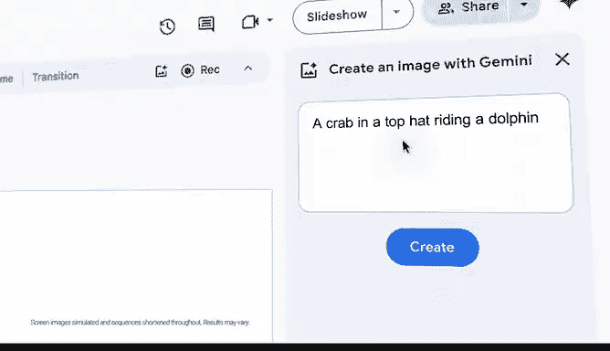
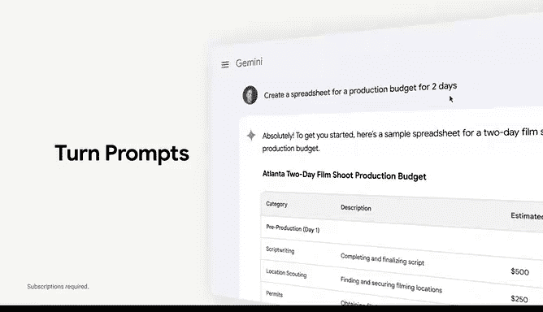
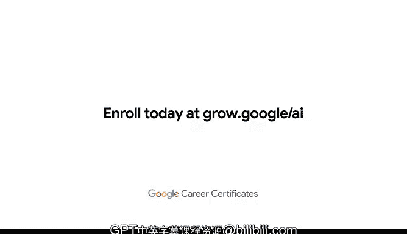

# 谷歌高阶数据分析 7：《谷歌高级数据分析项目》google-advanced-data-analytics-capstone（中英双字） - P14：14_02_10_谷歌人工智能基础课程介绍.zh_en - GPT中英字幕课程资源 - BV1qV4y1t7kk

I am。🎼Like them or the others。 Don't back down。 I don't for。🎼把他咋我。🎼Beginners， only winners。

I'm going to take you to the future。🎼后背快来。

🎼都 get命。🎼To side there it is to side that。

🎼Wow。

🎼好高花的。I'm going to take it to the future。

