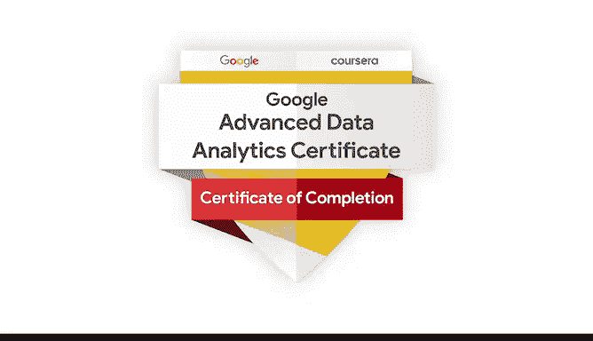

# 谷歌高阶数据分析 7：《谷歌高级数据分析项目》google-advanced-data-analytics-capstone（中英双字） - P15：15_03_01_恭喜完成谷歌高级数据分析证书课程.zh_en - GPT中英字幕课程资源 - BV1qV4y1t7kk

Great work。 You've reached the end of the programme。

 Remember when you made a commitment at the start of the programme to build upon your data analytics。

 knowledge and skills。 Well， after all of your hard work and dedication， you fulfilled that promise。

 I am honored to be the first to congratulate you on all you have accomplished。

 but I am certainly not the last。 There are a few other people waiting to speak to you。😊。

Congratulations on reaching the end of this course。 Incredible work。

 Congratulations on completing your certificate。 You should be proud of yourself。

 Congratulations on all your progress。 Well done。 Awesome job， everybody。 Congratulations。

 You finished the course。 Congratulations on completing this section of the program and good luck on the rest of your journey。

 Congratulations。 Good work。 congrats and hopefully I'll be working with you some day and getting a job at Google。

 Congratulations。 This was not an easy feat。 and you stuck through it。 Very proud of you。

 Martha good。 Congratulations。 You did a great job。 Good luck out there。 Congratulations。 You did it。

😊，Congratulations， you've made it to the end of the course so now go ahead。

 get your foot in the door and startifying You've done it。

 You finished the course I'm looking forward for you to be in my next interview and telling about all the wonderful things that you did and congrats congratulations Felic Cer Yajara。

😊，Congratulations， you did it。 Good luck with the rest of your data science journey。

 It's time to celebrate your achievement。 You worked very hard on completing this program and learned a tremendous amount about what it means to be a data professional。

 All that's left to do is collect your certificate of completion。

 which you can display on your resume or LinkedIn profile。

 I hope you are as proud of your accomplishment as I am。

 It's been fantastic supporting you on your learning journey throughout the program。

 And now it's time for you to get out there and make an impact in the data career space。

 Good bye for now。😊。

